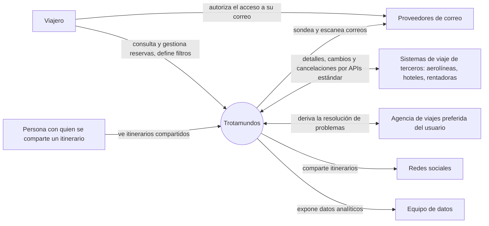

# Diagrama de contexto

**Qué es:** límites del sistema Trotamundos y sus interacciones con actores externos.
**Mantiene:** ambos. **Estado:** COMPLETADO.

## Diagrama

## Alcance

| Dentro del sistema | Fuera del sistema |
|---|---|
| Itinerario por viaje, ingesta de reservas, gestión manual, archivado, whitelists, compartición, derivación a la agencia, analítica, opción avanzada A o B (2da entrega) | Compra o emisión de reservas, pagos, los sistemas de aerolíneas, hoteles y rentadoras, los proveedores de correo |

## Elementos externos

| Actor | Interacción | Notas |
|---|---|---|
| Viajero | Web y móvil | Usa GPS en móvil (CON-4) |
| Persona con acceso compartido | Solo lectura de itinerarios designados | Tiene cuenta propia y acepta una invitación del dueño (iteración 4, ADR-0061) |
| Proveedores de correo | Lectura de buzones con autorización del usuario | Requiere consentimiento (OAuth) |
| Sistemas de terceros | APIs estándar: Trotamundos consulta y ellos notifican cambios | Latencias y disponibilidad fuera de nuestro control (CON-1, CON-2) |
| Agencia de viajes | Resolución de problemas (RF-06) | El canal se define en la iteración 2 |
| Redes sociales | Compartir itinerarios | Solo salida: se publica una tarjeta de resumen que no da acceso al itinerario (ADR-0063) |
| Equipo de datos | Consultas analíticas pesadas | No debe afectar a los usuarios |
