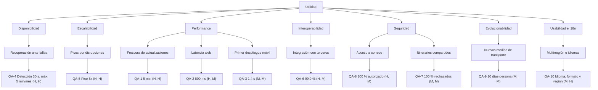

# Árbol de utilidad

**Qué es:** escenarios de calidad organizados por atributo y refinamiento, con (Importancia, Dificultad).
**Mantiene:** ambos. **Estado:** COMPLETADO (coincide con los escenarios revisados con `/test-QAs`).

Las prioridades de esta tabla son **propuestas a validar** (ningún stakeholder las confirmó todavía).

## Tabla de priorización

| ID | Atributo | Refinamiento | Escenario resumido | Prioridad (I, D) |
|---|---|---|---|---|
| QA-4 | Disponibilidad | Recuperación ante fallas | Detección en 30 s, redirección en 60 s; máx. 5 min/mes | (H, H) |
| QA-5 | Escalabilidad | Picos por disrupciones | 2 M usuarios activos y pico de 5x cumpliendo QA-1 y QA-2 | (H, H) |
| QA-1 | Performance | Frescura de actualizaciones | 99 % de las actualizaciones visibles en 5 min | (H, H) |
| QA-2 | Performance | Latencia web | 95 % de respuestas en 800 ms o menos | (H, M) |
| QA-3 | Performance | Primer despliegue móvil | Primer contenido en menos de 1,4 s | (M, M) |
| QA-6 | Interoperabilidad | Integración con terceros | 99,9 % de mensajes sin pérdida ni duplicación | (H, M) |
| QA-8 | Seguridad | Acceso a correos | 100 % de accesos con credenciales autorizadas | (H, M) |
| QA-7 | Seguridad | Itinerarios compartidos | 100 % de accesos no designados rechazados | (M, M) |
| QA-9 | Evolucionabilidad | Nuevos medios de transporte | Agregar un medio en 10 días-persona o menos | (M, M) |
| QA-10 | Usabilidad / i18n | Multirregión e idiomas | Idioma y formato del usuario; QA-2 y QA-3 también fuera de su región | (M, H) |

## Árbol

## Escenarios más críticos (H, H)

Son los de mayor importancia y dificultad. Los drivers principales son todos los de importancia alta (H), incluidos
los (H, M); ver [architectural-drivers.md](architectural-drivers.md).

- **QA-4 Disponibilidad:** 5 minutos por mes es muy exigente y el sistema es global.
- **QA-5 Escalabilidad:** la carga tiene picos fuertes e impredecibles, y el sistema debe seguir cumpliendo la latencia.
- **QA-1 Frescura:** depende de sistemas externos que no controlamos y de sondear correos a escala.

## Observaciones

- QA-10 es (M, H): importancia media y dificultad alta. Su parte multirregión se atiende igual en la iteración 1
  porque condiciona la estructura de despliegue; la parte de idiomas y formatos queda para la iteración 4.
- QA-3 (M, M) se atiende en la iteración 3 junto con QA-2.
- Las prioridades son una propuesta del equipo: ningún stakeholder las confirmó.
