# Árbol de utilidad

**Qué es:** escenarios de calidad organizados por atributo y refinamiento, con (Importancia, Dificultad).
**Mantiene:** ambos. **Estado:** COMPLETADO (coincide con los escenarios revisados con `/test-qas`).

Las prioridades de esta tabla fueron **aceptadas por el equipo** al cierre de la segunda entrega (2026-11-23).

## Tabla de priorización

| ID | Atributo | Refinamiento | Escenario resumido | Prioridad (I, D) |
|---|---|---|---|---|
| QA-4 | Disponibilidad | Recuperación ante fallas | Detección en 30 s, redirección en 60 s; máx. 5 min/mes | (H, H) |
| QA-5 | Escalabilidad | Picos por disrupciones | 2 M usuarios activos y pico de 5x cumpliendo QA-1 y QA-2 | (H, H) |
| QA-1 | Performance | Frescura de actualizaciones | 99 % de las actualizaciones visibles en 5 min | (H, H) |
| QA-2 | Performance | Latencia web | 95 % de respuestas en 800 ms o menos | (H, M) |
| QA-3 | Performance | Primer despliegue móvil | Primer contenido en menos de 1,4 s | (M, M) |
| QA-6 | Interoperabilidad | Integración con terceros | 99,9 % de mensajes sin pérdida ni duplicación | (H, M) |
| QA-8 | Seguridad | Acceso a correos | 100 % de accesos con credenciales autorizadas | (H, M) |
| QA-7 | Seguridad | Itinerarios compartidos | 100 % de accesos no designados rechazados | (M, M) |
| QA-9 | Evolucionabilidad | Nuevos medios de transporte | Agregar un medio en 10 días-persona o menos | (M, M) |
| QA-10 | Usabilidad / i18n | Multirregión e idiomas | Idioma y formato del usuario; QA-2 y QA-3 también fuera de su región | (M, H) |
| QA-12 | Escalabilidad | Disrupción masiva (2da entrega) | 15.000 afectados en 10 min, QA-11 para el 95 % y límites de proveedores respetados | (H, H) |
| QA-11 | Performance | Oportunidad de las sugerencias (2da entrega) | 95 % de sugerencias avisadas en 2 min | (H, M) |
| QA-13 | Usabilidad | Adaptación al usuario (2da entrega) | Reordenar en 2 s respetando límites; feedback inmediato y trabajo regional diario condicionado | (H, M) |
| QA-14 | Seguridad | Control del perfil (2da entrega) | 0 sugerencias tras desactivar; perfil borrado en 24 h | (H, M) |
| QA-16 | Disponibilidad | Falla de la recomendación (2da entrega) | Panel sin impacto; pendientes en 10 min tras recuperar | (H, M) |
| QA-17 | Disponibilidad | Proveedor de búsqueda caído (2da entrega) | Ninguna búsqueda perdida; pendientes en 10 min tras recuperar | (M, M) |
| QA-15 | Modificabilidad | Versiones del modelo (2da entrega) | Canario al 5 %, vuelta atrás en 5 min sin tocar otros procesos | (M, M) |

## Árbol

```mermaid
flowchart TD
    U["Utilidad"] --> D["Disponibilidad"]
    U --> S["Escalabilidad"]
    U --> P["Performance"]
    U --> I["Interoperabilidad"]
    U --> G["Seguridad"]
    U --> E["Evolucionabilidad"]
    U --> X["Usabilidad e i18n"]

    D --> D1["Recuperación ante fallas"]
    D1 --> QA4["QA-4 Detección 30 s, máx. 5 min/mes (H, H)"]
    S --> S1["Picos por disrupciones"]
    S1 --> QA5["QA-5 Pico 5x (H, H)"]
    P --> P1["Frescura de actualizaciones"]
    P1 --> QA1["QA-1 5 min (H, H)"]
    P --> P2["Latencia web"]
    P2 --> QA2["QA-2 800 ms (H, M)"]
    P --> P3["Primer despliegue móvil"]
    P3 --> QA3["QA-3 1,4 s (M, M)"]
    I --> I1["Integración con terceros"]
    I1 --> QA6["QA-6 99,9 % (H, M)"]
    G --> G1["Acceso a correos"]
    G1 --> QA8["QA-8 100 % autorizado (H, M)"]
    G --> G2["Itinerarios compartidos"]
    G2 --> QA7["QA-7 100 % rechazados (M, M)"]
    E --> E1["Nuevos medios de transporte"]
    E1 --> QA9["QA-9 10 días-persona (M, M)"]
    X --> X1["Multirregión e idiomas"]
    X1 --> QA10["QA-10 Idioma, formato y región (M, H)"]
    S --> S2["Disrupción masiva (2da entrega)"]
    S2 --> QA12["QA-12 15.000 afectados en 10 min (H, H)"]
    P --> P4["Oportunidad de las sugerencias (2da entrega)"]
    P4 --> QA11["QA-11 2 min (H, M)"]
    X --> X2["Adaptación al usuario (2da entrega)"]
    X2 --> QA13["QA-13 2 s y feedback inmediato (H, M)"]
    G --> G3["Control del perfil (2da entrega)"]
    G3 --> QA14["QA-14 Borrado en 24 h (H, M)"]
    D --> D2["Falla de la recomendación (2da entrega)"]
    D2 --> QA16["QA-16 Panel sin impacto (H, M)"]
    D --> D3["Proveedor de búsqueda caído (2da entrega)"]
    D3 --> QA17["QA-17 Pendientes en 10 min (M, M)"]
    E --> E2["Versiones del modelo (2da entrega)"]
    E2 --> QA15["QA-15 Vuelta atrás en 5 min (M, M)"]
```

## Escenarios más críticos (H, H)

Son los de mayor importancia y dificultad. Los drivers principales son todos los de importancia alta (H), incluidos
los (H, M); ver [architectural-drivers.md](architectural-drivers.md).

- **QA-4 Disponibilidad:** 5 minutos por mes es muy exigente y el sistema es global.
- **QA-5 Escalabilidad:** la carga tiene picos fuertes e impredecibles, y el sistema debe seguir cumpliendo la latencia.
- **QA-1 Frescura:** depende de sistemas externos que no controlamos y de sondear correos a escala.

## Observaciones

- QA-10 es (M, H): importancia media y dificultad alta. Su parte multirregión se atiende igual en la iteración 1
  porque condiciona la estructura de despliegue; la parte de idiomas y formatos queda para la iteración 4.
- QA-3 (M, M) se atiende en la iteración 3 junto con QA-2.
- Las prioridades las definió y aceptó el equipo al cierre de la segunda entrega.
- Los escenarios QA-11 a QA-17 son de la 2da entrega (opción A, RF-09) y se atienden en la
  [iteración 5](../01-add/iteration-5-recommendation.md). QA-12 es (H, H) porque las cancelaciones masivas
  coinciden con los picos de QA-5 y dependen de proveedores externos con límites de consulta. QA-17 salió de dividir
  QA-16 (antes tenía dos fuentes de estímulo, auditoría de la iteración 5); es (M, M) porque solo atrasa sugerencias.
