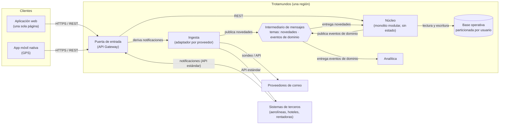

# Vista de componentes y conectores

**Tipo:** C&C (en ejecución)
**Actualizada en la iteración:** 1
**Mantiene:** Ambos
**Estado:** Versión inicial (iteración 1). Las iteraciones 2, 3 y 4 la refinan.

## 1. Propósito

Mostrar los elementos que existen en ejecución y cómo se comunican. Sirve para razonar sobre performance,
disponibilidad, seguridad y escalabilidad. Muestra **una región**; todas las regiones tienen la misma estructura
(ver [vista de despliegue](deployment-view.md)). La entrada global que elige la región no aparece acá: está en la
vista de despliegue.

## 2. Presentación primaria

Leyenda: rectángulo = proceso; cilindro = almacenamiento; hexágono = intermediario de mensajes; flecha = conector
en la dirección de la solicitud o del mensaje.

## 3. Catálogo de elementos

| Elemento | Responsabilidad | Iteración que lo refina |
|---|---|---|
| Aplicación web | Panel de viajes y carga manual de reservas | 3 |
| App móvil | Panel de viajes y GPS (CON-4) | 3 |
| Puerta de entrada | Único punto de entrada a la región; valida identidad, balancea y limita tráfico; deriva las notificaciones de terceros a la ingesta | 2, 3, 4 |
| Núcleo | Único dueño del estado de viajes y reservas; aplica novedades; publica eventos de dominio; archiva viajes completados | 3 |
| Base operativa | Datos del núcleo de los usuarios de la región, particionados por usuario | 3 |
| Intermediario de mensajes | Conserva y entrega los mensajes de los dos temas | 2 |
| Ingesta | Sondea correos, recibe notificaciones y consulta a terceros, traduce al modelo canónico y publica novedades | 2 |
| Analítica | Consume eventos de dominio sin compartir recursos con la consulta | 4 |

## 4. Conectores

| De | A | Estilo | Contrato en `specs/` |
|---|---|---|---|
| Clientes | Puerta de entrada | Síncrono, HTTPS/REST | `openapi/itinerary-api.example.yaml` |
| Puerta de entrada | Núcleo | Síncrono, REST | `openapi/itinerary-api.example.yaml` |
| Ingesta | Intermediario (tema novedades) | Asíncrono, publicación | `asyncapi/` (a crear) |
| Intermediario (tema novedades) | Núcleo | Asíncrono, suscripción | `asyncapi/` (a crear) |
| Núcleo | Intermediario (tema eventos de dominio) | Asíncrono, publicación | `asyncapi/` (a crear) |
| Intermediario (tema eventos de dominio) | Analítica | Asíncrono, suscripción | `asyncapi/` (a crear) |
| Ingesta | Proveedores de correo y terceros | Síncrono, API del proveedor (sondeo y consulta) | Externo (CON-1, CON-2) |
| Terceros | Puerta de entrada → Ingesta | Síncrono, notificaciones por API estándar | Externo; se detalla en la iteración 2 |

## 5. Elementos compartidos entre iteraciones

Núcleo, intermediario de mensajes y los dos temas, modelo canónico de reserva, base operativa y su clave de
partición. Cualquier cambio sobre ellos se anota en [impact-log.md](../01-add/impact-log.md).

## 6. Rationale

| Decisión | ADR |
|---|---|
| Clientes ricos y puerta de entrada única | [0004](../03-adr/0004-arquitectura-de-referencia-clientes-ricos-y-puerta-de-entrada.md) |
| Núcleo modular; ingesta y analítica como procesos separados | [0001](../03-adr/0001-nucleo-modular-con-procesos-separados.md) |
| Comunicación asincrónica por publicación y suscripción | [0002](../03-adr/0002-mensajeria-persistente-con-publicacion-suscripcion.md) |

## 7. Drivers que sustenta

| Driver | Cómo lo sustenta |
|---|---|
| QA-1 | La ingesta escala por separado y el broker amortigua las ráfagas de los proveedores |
| QA-4 | Si la ingesta o la analítica fallan, la consulta (clientes → puerta → núcleo → base) sigue funcionando |
| QA-5 | Núcleo sin estado detrás de la puerta de entrada; cada proceso escala por su cuenta |
| QA-9 | Productores y consumidores no se conocen; los adaptadores aíslan a cada proveedor |

## 8. Vistas relacionadas

[Módulos](module-view.md) · [Despliegue](deployment-view.md) · [Secuencias](sequence-views.md)

## Detalle de ingesta alineado

Ver [ingestion-view.md](ingestion-view.md). Se conserva la vista general de la primera iteración: avisos por entrada global y Gateway, núcleo único dueño de reservas y dos flujos de mensajes.
