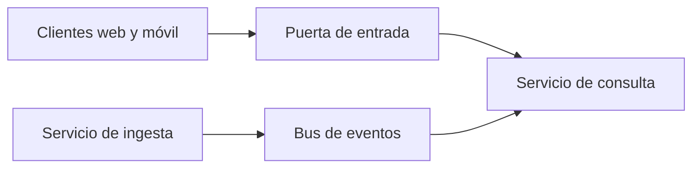

# Vista de componentes y conectores

**Tipo:** C&C (en ejecución)
**Actualizada en la iteración:** `<N>`
**Mantiene:** `<A | B | Ambos>`
**Estado:** PENDIENTE (versión inicial en la iteración 1; la 2, 3 y 4 la refinan)

## 1. Propósito

Mostrar los elementos que existen en ejecución y cómo se comunican. Sirve para razonar sobre performance,
disponibilidad, seguridad y escalabilidad.

## 2. Presentación primaria

<!-- Esto es solo un esqueleto para que el diagrama renderice. Reemplazar en la iteración 1. -->

## 3. Catálogo de elementos

| Elemento | Responsabilidad | Iteración que lo refina |
|---|---|---|
|  |  |  |

## 4. Conectores

| De | A | Estilo (síncrono, asíncrono, evento) | Contrato en `specs/` |
|---|---|---|---|
|  |  |  |  |

## 5. Elementos compartidos entre iteraciones

<!-- Marcar acá los elementos que usan 2 o más iteraciones. Ver ../01-add/impact-log.md -->

## 6. Rationale

| Decisión | ADR |
|---|---|
|  |  |

## 7. Drivers que sustenta

| Driver | Cómo lo sustenta |
|---|---|
| QA-1 |  |
| QA-2 |  |
| QA-5 |  |

## 8. Vistas relacionadas

[Módulos](module-view.md) · [Despliegue](deployment-view.md) · [Secuencias](sequence-views.md)

## Refinamiento de ingesta — propuesta de iteración 2

Ver [ingestion-view.md](ingestion-view.md). El diagrama de arriba sigue siendo una plantilla de la iteración 1.
En el refinamiento acordado, ingesta publica una novedad y el núcleo valida/aplica el estado: la flecha al servicio
de consulta no implica escritura directa de ingesta ni un evento confirmado para analítica. Revisar la unión de
ambas vistas cuando la primera iteración se publique.
