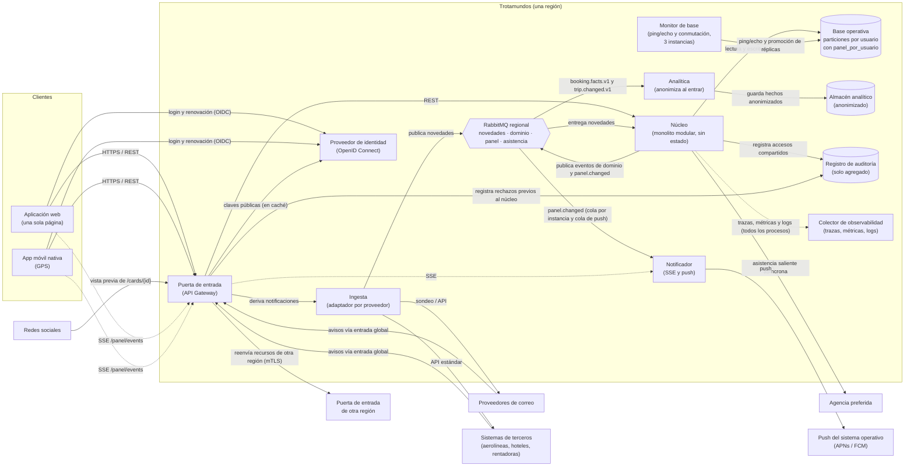

# Vista de componentes y conectores

**Tipo:** C&C (en ejecución)
**Actualizada en la iteración:** 4
**Mantiene:** Ambos
**Estado:** Refinada en las iteraciones 2, 3 y 4.

## 1. Propósito

Mostrar los elementos que existen en ejecución y cómo se comunican. Sirve para razonar sobre performance,
disponibilidad, seguridad y escalabilidad. Muestra **una región**; todas las regiones tienen la misma estructura
(ver [vista de despliegue](deployment-view.md)). La entrada global que elige la región no aparece acá: está en la
vista de despliegue.

## 2. Presentación primaria

Leyenda: rectángulo = proceso; cilindro = almacenamiento; hexágono = intermediario de mensajes; flecha = conector
en la dirección de la solicitud o del mensaje. La flecha punteada al colector representa a todos los procesos de la
región (ingesta, núcleo, notificador, analítica, puerta de entrada), que envían trazas, métricas y logs; se dibuja una
sola para no recargar el diagrama.

## 3. Catálogo de elementos

| Elemento | Responsabilidad | Iteración que lo refina |
|---|---|---|
| Aplicación web | Panel de viajes y carga manual de reservas | 3 |
| App móvil | Panel de viajes y GPS (CON-4) | 3 |
| Puerta de entrada | Único punto de entrada a la región; valida tokens y tickets SSE (ADR-0060), balancea y limita tráfico; deriva las notificaciones de terceros a la ingesta; reenvía a otra región los recursos con su prefijo (ADR-0062); sirve los catálogos de textos (ADR-0065) | 2, 3, 4 |
| Núcleo | Único dueño del estado de viajes y reservas; aplica novedades; publica eventos de dominio; archiva viajes completados; controla la compartición y escribe la auditoría (ADR-0061); genera la tarjeta para redes (ADR-0063) | 3, 4 |
| Base operativa | Datos del núcleo de los usuarios de la región en particiones por usuario; incluye `panel_por_usuario` (ADR-0040, ADR-0042) | 3 |
| Intermediario de mensajes | Conserva mensajes de novedades, dominio y asistencia | 2 |
| Ingesta | Sondea correos, recibe notificaciones y consulta a terceros, traduce al modelo canónico y publica novedades | 2 |
| Analítica | Consume `booking.facts.v1` y `trip.changed.v1`, anonimiza y guarda; no lee la base operativa (ADR-0064) | 4 |
| Almacén analítico | Hechos anonimizados de la región para consultas pesadas del equipo de datos (ADR-0064) | 4 |
| Proveedor de identidad | Login, tokens de 15 min, renovación y revocación de los usuarios de la región (ADR-0060) | 4 |
| Registro de auditoría | Registros de solo agregado de los accesos a viajes compartidos de la región; lo escriben el núcleo y la puerta de entrada (ADR-0061) | 4 |
| Colector de observabilidad | Recibe trazas, métricas y logs de la región y dispara alertas (ADR-0067) | 4 |
| Notificador | Consume `panel.changed.v1`; avisa a las apps abiertas por SSE y a las cerradas por push; no lleva datos de reservas (ADR-0046) | 3 |
| Monitor de base | Tres instancias (zonas A, B y C); detecta primarias caídas en 30 s y promueve la réplica con acuerdo de dos de tres (ADR-0042) | 3 |

## 4. Conectores

| De | A | Estilo | Contrato en `specs/` |
|---|---|---|---|
| Clientes | Puerta de entrada | Síncrono, HTTPS/REST | [itinerary-api.v1.yaml](../../specs/openapi/itinerary-api.v1.yaml) |
| Puerta de entrada | Núcleo | Síncrono, REST | [itinerary-api.v1.yaml](../../specs/openapi/itinerary-api.v1.yaml) |
| Clientes | Puerta de entrada → Notificador | SSE (`/panel/events?ticket=...`), versión del panel y `correlationIds`; ticket firmado de 30 s (ADR-0060) | [itinerary-api.v1.yaml](../../specs/openapi/itinerary-api.v1.yaml) |
| Clientes | Proveedor de identidad | Síncrono, OpenID Connect (login y renovación) | Estándar OIDC |
| Puerta de entrada | Puerta de entrada de otra región | Síncrono, REST sobre mTLS, con el token original del usuario (ADR-0062) | [itinerary-api.v1.yaml](../../specs/openapi/itinerary-api.v1.yaml) |
| Núcleo | Registro de auditoría | Escritura de solo agregado antes de responder (ADR-0061) | [access-audit.md](../../specs/access-audit.md) |
| Puerta de entrada | Registro de auditoría | Escritura de solo agregado de los rechazos que ocurren antes de llegar al núcleo del dueño (ADR-0061) | [access-audit.md](../../specs/access-audit.md) |
| Redes sociales | Puerta de entrada (`/cards/{id}`) | Síncrono, HTML con metadatos Open Graph, sin autenticación (ADR-0063) | [itinerary-api.v1.yaml](../../specs/openapi/itinerary-api.v1.yaml) |
| Todos los procesos | Colector de observabilidad | Asíncrono, OpenTelemetry (ADR-0067) | Estándar OpenTelemetry |
| Intermediario (`panel.changed.v1`) | Notificador | Asíncrono: una cola exclusiva por instancia (todos los avisos) y una cola compartida `notifier.push` | [panel-changed.v1.yaml](../../specs/asyncapi/panel-changed.v1.yaml) |
| Notificador | Servicios de push del sistema operativo | Asíncrono, externo | Externo |
| Ingesta | Intermediario (tema novedades) | Asíncrono, publicación | `asyncapi/booking-change-detected.v1.yaml` |
| Intermediario (tema novedades) | Núcleo | Asíncrono, suscripción | `asyncapi/booking-change-detected.v1.yaml` |
| Núcleo | Intermediario (exchange `travel.domain`) | Asíncrono, publicación desde la outbox | [booking-confirmed.v1.yaml](../../specs/asyncapi/booking-confirmed.v1.yaml), [trip-changed.v1.yaml](../../specs/asyncapi/trip-changed.v1.yaml), [panel-changed.v1.yaml](../../specs/asyncapi/panel-changed.v1.yaml), [booking-facts.v1.yaml](../../specs/asyncapi/booking-facts.v1.yaml) |
| Intermediario (eventos de dominio) | Analítica | Asíncrono, suscripción con cola propia | [booking-facts.v1.yaml](../../specs/asyncapi/booking-facts.v1.yaml), [trip-changed.v1.yaml](../../specs/asyncapi/trip-changed.v1.yaml) |
| Ingesta | Proveedores de correo y terceros | Síncrono, API del proveedor (sondeo y consulta) | Externo (CON-1, CON-2) |
| Terceros | Puerta de entrada → Ingesta | Síncrono, notificaciones por API estándar | Externo; se detalla en la iteración 2 |

## 5. Elementos compartidos entre iteraciones

Núcleo, intermediario de mensajes y sus exchanges (novedades, dominio, asistencia), modelo canónico de reserva, base operativa y su clave de
partición. Cualquier cambio sobre ellos se anota en [impact-log.md](../01-add/impact-log.md).

## 6. Rationale

| Decisión | ADR |
|---|---|
| Clientes ricos y puerta de entrada única | [0004](../03-adr/0004-arquitectura-de-referencia-clientes-ricos-y-puerta-de-entrada.md) |
| Núcleo modular; ingesta y analítica como procesos separados | [0001](../03-adr/0001-nucleo-modular-con-procesos-separados.md) |
| Comunicación asincrónica por publicación y suscripción | [0002](../03-adr/0002-mensajeria-persistente-con-publicacion-suscripcion.md) |
| Modelo de lectura del panel | [0040](../03-adr/0040-modelo-de-lectura-del-panel.md) |
| Caché local del panel | [0041](../03-adr/0041-cache-local-del-panel.md) |
| Notificador, evento `panel.changed.v1` y cola por instancia | [0046](../03-adr/0046-notificador-de-cambios-del-panel.md) |
| Particiones por usuario y monitor de base | [0042](../03-adr/0042-particion-de-la-base-por-usuario.md) |
| Límites y prioridades en la puerta de entrada | [0047](../03-adr/0047-priorizacion-y-degradacion-ante-sobrecarga.md) |
| Identidad por región y tokens | [0060](../03-adr/0060-identidad-por-region-con-tokens.md) |
| Compartición y auditoría | [0061](../03-adr/0061-comparticion-con-cuenta-y-auditoria.md) |
| Reenvío entre regiones | [0062](../03-adr/0062-lectura-de-viajes-compartidos-entre-regiones.md) |
| Tarjeta para redes sociales | [0063](../03-adr/0063-tarjeta-de-resumen-para-redes-sociales.md) |
| Analítica regional anonimizada | [0064](../03-adr/0064-analitica-regional-anonimizada.md) |
| Observabilidad | [0067](../03-adr/0067-observabilidad-con-trazas-y-metricas.md) |

## 7. Drivers que sustenta

| Driver | Cómo lo sustenta |
|---|---|
| QA-1 | La ingesta escala por separado y el broker amortigua las ráfagas de los proveedores; el notificador lleva el cambio a la pantalla |
| QA-2 | El panel es una lectura por clave en la partición del usuario |
| QA-3 | La app muestra su caché local sin esperar la red |
| QA-4 | Si la ingesta o la analítica fallan, la consulta (clientes → puerta → núcleo → base) sigue funcionando |
| QA-5 | Núcleo sin estado detrás de la puerta de entrada; cada proceso escala por su cuenta |
| QA-7 | Solo la puerta de entrada recibe solicitudes externas y valida el token; el núcleo verifica el permiso de todo pedido sobre un viaje ajeno; el núcleo y la puerta auditan cada intento |
| QA-9 | Productores y consumidores no se conocen; los adaptadores aíslan a cada proveedor; los detalles por tipo no pasan por la lógica del núcleo |
| QA-10 | El backend devuelve datos neutros y la puerta de entrada sirve los catálogos; los clientes formatean |
| RF-07 | La analítica tiene su propio almacén y no comparte recursos con la consulta |
| CRN-2 | Todos los procesos envían trazas, métricas y logs al colector de su región |

## 8. Vistas relacionadas

[Módulos](module-view.md) · [Despliegue](deployment-view.md) · [Secuencias](sequence-views.md)

## Detalle de ingesta alineado

Ver [ingestion-view.md](ingestion-view.md). Se conserva la vista general de la primera iteración: avisos por entrada global y Gateway, núcleo único dueño de reservas y dos flujos de mensajes.

## Asistencia saliente y correo por avisos

El núcleo contiene el módulo saliente de asistencia (ADR-0026), con trabajo persistente, adaptador y recursos
acotados. No es una función de ingesta. Los avisos de correo y terceros pasan por entrada global y Gateway;
el sondeo de reconciliación permanece como respaldo. Ver [operación](../../specs/ingestion-operations.md).
