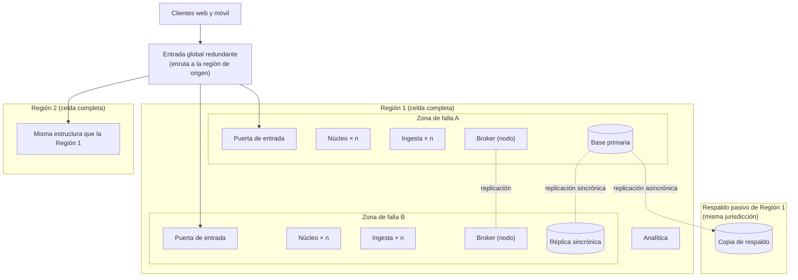

# Vista de despliegue

**Tipo:** Asignación (software a infraestructura)
**Actualizada en la iteración:** 1
**Mantiene:** Ambos
**Estado:** Versión inicial (iteración 1). La iteración 3 la refina (escalado, tiempos de conmutación).

## 1. Propósito

Mostrar dónde corre cada elemento. Sirve para razonar sobre escalabilidad, disponibilidad y multirregión.

## 2. Presentación primaria

## 3. Catálogo de elementos

| Nodo o recurso | Qué corre | Réplicas | Observaciones |
|---|---|---|---|
| Entrada global | Enrutamiento por región de origen | Redundante | Resuelve la región a partir de la identidad del usuario |
| Región (celda) | Todos los procesos y datos de los usuarios con esa región de origen | Una por mercado | Sumar una región es desplegar una celda más |
| Zona de falla | Puerta de entrada, núcleo, ingesta, broker y base | Al menos 2 por región | Redundancia activa: todas las zonas atienden tráfico |
| Base operativa | Datos de la región, particionados por usuario | Primaria + réplica sincrónica en otra zona | Conmutación automática |
| Región de respaldo | Copia de los datos de una región | 1 por región, misma jurisdicción | Redundancia pasiva para la falla de una región completa |
| Analítica | Proceso analítico | Por región | Dónde se agregan los datos de todas las regiones: iteración 4 |

## 4. Rationale

| Decisión | ADR |
|---|---|
| Multirregión con región de origen; zonas de falla; respaldo en la misma jurisdicción | [0004](../03-adr/0004-despliegue-por-regiones-con-region-de-origen.md) |
| Puerta de entrada redundante como único acceso | [0005](../03-adr/0005-arquitectura-de-referencia-clientes-ricos-y-puerta-de-entrada.md) |

## 5. Drivers que sustenta

| Driver | Cómo lo sustenta |
|---|---|
| QA-4 Disponibilidad | La falla de una instancia o zona se absorbe con las otras zonas (redundancia activa) |
| QA-5 Escalabilidad | Cada proceso tiene `n` instancias por zona y escala por separado |
| QA-10 Multirregión | Cada región es una celda independiente que atiende a sus usuarios |
| CON-3 (suposición) | Los datos de un usuario y su respaldo quedan en la misma jurisdicción |

## 6. Prototipo

El prototipo corre una sola región en una máquina con `docker compose` (núcleo, ingesta y broker). La multirregión y
las zonas se documentan acá, pero no se simulan.

## 7. Vistas relacionadas

[Componentes y conectores](cc-view.md) · [Módulos](module-view.md)
