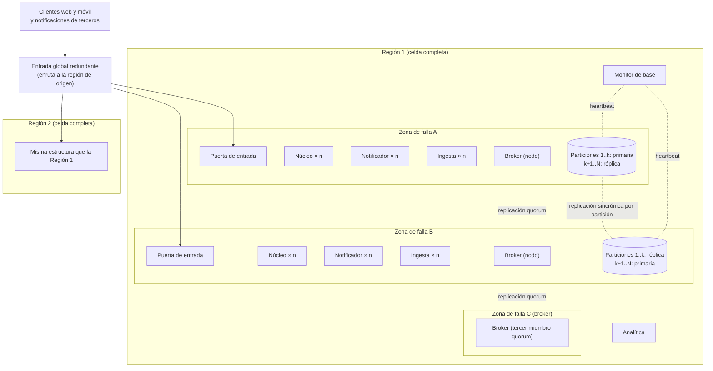

# Vista de despliegue

**Tipo:** Asignación (software a infraestructura)
**Actualizada en la iteración:** 3
**Mantiene:** Ambos
**Estado:** Refinada en la iteración 3 (particiones, notificador, escalado y conmutación).

## 1. Propósito

Mostrar dónde corre cada elemento. Sirve para razonar sobre escalabilidad, disponibilidad y multirregión.

## 2. Presentación primaria

## 3. Catálogo de elementos

| Nodo o recurso | Qué corre | Réplicas | Observaciones |
|---|---|---|---|
| Entrada global | Enrutamiento por región de origen | Redundante | Resuelve la región a partir de la identidad del usuario; para notificaciones de terceros, se resuelve en la iteración 2 |
| Región (celda) | Todos los procesos y datos de los usuarios con esa región de origen | Una por mercado | Sumar una región es desplegar una celda más |
| Zona de falla | Puerta de entrada, núcleo, ingesta, broker y base | Al menos 2 por región | Redundancia activa de los procesos: todas las zonas atienden tráfico; la base es primaria en una zona y réplica en la otra (redundancia pasiva) |
| Base operativa | Particiones lógicas por hash de usuario, repartidas en nodos físicos (ADR-0042) | Cada nodo: primaria en una zona y réplica sincrónica en otra; las primarias se reparten entre zonas | El monitor detecta en 30 s y promueve la réplica en 60 s, sin pérdida de datos |
| Notificador | Conexiones SSE y envío de push (ADR-0041) | Varias instancias por zona; escala por conexiones abiertas | Si cae, la app sigue con su caché |
| Monitor de base | Heartbeat de primarias y promoción de réplicas | Redundante | Componente de operación |
| Analítica | Proceso analítico | Por región | Dónde se agregan los datos de todas las regiones: iteración 4 |

## 4. Rationale

| Decisión | ADR |
|---|---|
| Multirregión con región de origen; zonas de falla | [0003](../03-adr/0003-despliegue-por-regiones-con-region-de-origen.md) |
| Puerta de entrada por región, redundante, como único acceso | [0004](../03-adr/0004-arquitectura-de-referencia-clientes-ricos-y-puerta-de-entrada.md) |
| Particiones con réplica sincrónica y monitor de base | [0042](../03-adr/0042-particion-de-la-base-por-usuario.md) |
| Notificador por región | [0041](../03-adr/0041-cache-local-y-notificador.md) |
| Escalado reactivo con capacidad mínima | [0043](../03-adr/0043-escalado-reactivo-y-degradacion.md) |

## 5. Drivers que sustenta

| Driver | Cómo lo sustenta |
|---|---|
| QA-4 Disponibilidad | La falla de una instancia o zona se absorbe con las otras zonas (redundancia activa); la de una primaria, con la réplica (redundancia pasiva) |
| QA-5 Escalabilidad | Cada proceso tiene `n` instancias por zona y escala por separado según su métrica; la base crece moviendo particiones a nodos nuevos |
| QA-10 Multirregión | Cada región es una celda independiente que atiende a sus usuarios |
| CON-3 (suposición) | Los datos de un usuario quedan en su región de origen |

## 6. Prototipo

El prototipo corre una sola región en una máquina con `docker compose` (núcleo, ingesta y broker). La multirregión y
las zonas se documentan acá, pero no se simulan.

## 7. Vistas relacionadas

[Componentes y conectores](cc-view.md) · [Módulos](module-view.md)

## Refinamiento de broker de la iteración 2

ADR-0028 elige RabbitMQ con tres miembros quorum en tres zonas distintas por región. La tercera zona del dibujo
aloja el tercer miembro; el mínimo inicial de dos zonas para procesos generales no se interpreta como quorum
suficiente en un cluster de dos nodos. Perder una zona conserva dos de tres miembros. Si la infraestructura no
ofrece esas tres zonas, registrar limitación y no afirmar tolerancia a la caída de cualquiera de ellas.
[Políticas](../../specs/ingestion-operations.md). El prototipo funcional de un nodo no valida disponibilidad zonal.

## Escalado (iteración 3)

| Proceso | Métrica de escalado | Capacidad mínima |
|---|---|---|
| Núcleo | Solicitudes por segundo y latencia del panel | Doble de la carga promedio; escala al 60 % de uso |
| Notificador | Conexiones abiertas | Doble del promedio de conexiones |
| Ingesta y consumidor de novedades | Antigüedad de la cola | Según la iteración 2 |
| Base | No escala automáticamente | Particiones dimensionadas para el pico; se amplían de forma planificada |

Ver [ADR-0043](../03-adr/0043-escalado-reactivo-y-degradacion.md). El prototipo no simula zonas ni escalado.
