# Vista de despliegue

**Tipo:** Asignación (software a infraestructura)
**Actualizada en la iteración:** 4
**Mantiene:** Ambos
**Estado:** Refinada en la iteración 3 (particiones, notificador, escalado y conmutación) y en la iteración 4
(identidad, auditoría, analítica, observabilidad y canal entre regiones).

## 1. Propósito

Mostrar dónde corre cada elemento. Sirve para razonar sobre escalabilidad, disponibilidad y multirregión.

## 2. Presentación primaria

```mermaid
flowchart TB
    U["Clientes web y móvil<br/>y notificaciones de terceros"] --> E["Entrada global redundante<br/>(enruta a la región de origen)"]
    E -. "login: hash(email) a región" .- DIR[("Directorio global de regiones<br/>(sin datos personales legibles,<br/>replicado en varias regiones)")]

    subgraph R1["Región 1 (celda completa)"]
        direction TB
        subgraph Z1["Zona de falla A"]
            G1["Puerta de entrada"]
            N1["Núcleo × n"]
            NT1["Notificador × n"]
            I1["Ingesta × n"]
            B1["Broker (nodo)"]
            D1[("Nodos de base 1..k: primaria<br/>k+1..N: réplica")]
            MB1["Monitor de base"]
            IDP1["Proveedor de identidad"]
            AU1[("Auditoría: primaria")]
            OT1["Colector de observabilidad"]
        end
        subgraph Z2["Zona de falla B"]
            G2["Puerta de entrada"]
            N2["Núcleo × n"]
            NT2["Notificador × n"]
            I2["Ingesta × n"]
            B2["Broker (nodo)"]
            D2[("Nodos de base 1..k: réplica<br/>k+1..N: primaria")]
            MB2["Monitor de base"]
            IDP2["Proveedor de identidad"]
            AU2[("Auditoría: réplica")]
            OT2["Colector de observabilidad"]
        end
        subgraph Z3["Zona de falla C"]
            B3["Broker (tercer miembro quorum)"]
            MB3["Monitor de base"]
            DC[("Réplicas reconstruidas<br/>si cae una zona")]
        end
        A1["Analítica"]
        AS1[("Almacén analítico<br/>(anonimizado)")]
        A1 --- AS1
        D1 -. "replicación sincrónica por nodo" .- D2
        AU1 -. "replicación sincrónica" .- AU2
        MB1 -. "ping/echo" .- D1
        MB2 -. "ping/echo" .- D2
        MB1 -. "acuerdo 2 de 3" .- MB3
        B1 -. "replicación quorum" .- B2
        B2 -. "replicación quorum" .- B3
    end

    subgraph R2["Región 2 (celda completa)"]
        X2["Misma estructura que la Región 1"]
    end

    E --> G1
    E --> G2
    E --> X2
    G1 <-. "mTLS entre regiones<br/>(viajes compartidos)" .-> X2
```

## 3. Catálogo de elementos

| Nodo o recurso | Qué corre | Réplicas | Observaciones |
|---|---|---|---|
| Entrada global | Enrutamiento por región de origen | Redundante | Resuelve la región a partir de la identidad del usuario; para notificaciones de terceros usa el directorio mínimo de suscripciones (ADR-0025) |
| Región (celda) | Todos los procesos y datos de los usuarios con esa región de origen | Una por mercado | Sumar una región es desplegar una celda más |
| Zona de falla | A y B: puerta de entrada, núcleo, notificador, ingesta, broker, base y monitor. C: tercer miembro del broker, tercer monitor y réplicas reconstruidas | 3 por región | Táctica *redundant spare*: todas las instancias de los procesos atienden tráfico; cada nodo de la base tiene una réplica sincrónica (*hot spare*) en la otra zona |
| Base operativa | Particiones lógicas por hash de usuario, repartidas en nodos físicos (ADR-0042) | Cada nodo: primaria en una zona y réplica sincrónica en otra; las primarias se reparten entre A y B | La unidad de falla es el nodo. Si cae una zona, las réplicas se promueven y las réplicas nuevas se crean en C |
| Notificador | Conexiones SSE y envío de push (ADR-0046) | Varias instancias en A y B; escala por conexiones abiertas | Cada instancia tiene su cola de avisos; si cae, la app sigue con su caché |
| Monitor de base | *Ping/echo* a las primarias cada 5 s; promoción de réplicas | 3 instancias, una por zona | Una promoción requiere acuerdo de dos de tres, para evitar promociones dobles |
| Analítica y almacén analítico | Consumo de `booking.facts.v1` y `trip.changed.v1`, anonimización y consultas pesadas (ADR-0064) | Por región; no hay almacén global | No está en el camino de los viajeros: su caída solo atrasa los datos analíticos, que esperan en su cola |
| Directorio global de regiones | `hash(email)` → región para el login (ADR-0060) | Replicado en varias regiones, como la entrada global | Sin datos personales legibles; si cae, no se puede iniciar sesión, pero quien ya tiene token sigue |
| Proveedor de identidad | Login, tokens y revocación de los usuarios de la región (ADR-0060) | Instancias en A y B | Guarda credenciales y emails solo de su región (CON-3) |
| Registro de auditoría | Accesos a viajes compartidos (ADR-0061) | Primaria en A y réplica sincrónica en B | Si no se puede escribir, la lectura compartida se rechaza (`503`) |
| Colector de observabilidad | Trazas, métricas, logs y alertas (ADR-0067) | Instancias en A y B | Guarda los datos en la región; si cae, los procesos siguen funcionando y se pierde observabilidad, no servicio |
| Canal entre regiones | Reenvío de solicitudes de viajes compartidos (ADR-0062) | Entre las puertas de entrada de cada par de regiones | mTLS; lleva el token original del usuario |

## 4. Rationale

| Decisión | ADR |
|---|---|
| Multirregión con región de origen; zonas de falla | [0003](../03-adr/0003-despliegue-por-regiones-con-region-de-origen.md) |
| Puerta de entrada por región, redundante, como único acceso | [0004](../03-adr/0004-arquitectura-de-referencia-clientes-ricos-y-puerta-de-entrada.md) |
| Particiones con réplica sincrónica y monitor de base | [0042](../03-adr/0042-particion-de-la-base-por-usuario.md) |
| Notificador por región | [0046](../03-adr/0046-notificador-de-cambios-del-panel.md) |
| Escalado solo reactivo, con escalado temprano | [0043](../03-adr/0043-escalado-solo-reactivo.md) |
| Identidad por región y directorio global | [0060](../03-adr/0060-identidad-por-region-con-tokens.md) |
| Auditoría por región | [0061](../03-adr/0061-comparticion-con-cuenta-y-auditoria.md) |
| Canal entre regiones | [0062](../03-adr/0062-lectura-de-viajes-compartidos-entre-regiones.md) |
| Analítica solo regional | [0064](../03-adr/0064-analitica-regional-anonimizada.md) |
| Colector por región | [0067](../03-adr/0067-observabilidad-con-trazas-y-metricas.md) |

## 5. Drivers que sustenta

| Driver | Cómo lo sustenta |
|---|---|
| QA-4 Disponibilidad | La falla de una instancia o zona se absorbe con las otras zonas; la de una primaria, con su réplica sincrónica (*redundant spare*); el monitor detecta con *ping/echo* |
| QA-5 Escalabilidad | Cada proceso tiene `n` instancias por zona y escala por separado según su métrica; la base crece moviendo particiones a nodos nuevos |
| QA-10 Multirregión | Cada región es una celda independiente que atiende a sus usuarios |
| CON-3 (suposición) | Los datos de un usuario quedan en su región de origen: identidad, auditoría, analítica y observabilidad también son regionales; un viaje compartido se lee en su región sin copiarse |
| QA-7 | Identidad y auditoría con redundancia en dos zonas |

## 6. Prototipo

El prototipo corre una sola región en una máquina con `docker compose` (núcleo, notificador, ingesta, broker y una
base con dos particiones lógicas). La iteración 4 agrega un proveedor de identidad local y una segunda instancia que
hace de otra región para probar el reenvío. La multirregión real, las zonas, el monitor, el directorio global y el
escalado se documentan acá, pero no se simulan.

## 7. Vistas relacionadas

[Componentes y conectores](cc-view.md) · [Módulos](module-view.md)

## Refinamiento de broker de la iteración 2

ADR-0028 elige RabbitMQ con tres miembros quorum en tres zonas distintas por región. La tercera zona del dibujo
aloja el tercer miembro; el mínimo inicial de dos zonas para procesos generales no se interpreta como quorum
suficiente en un cluster de dos nodos. Perder una zona conserva dos de tres miembros. Si la infraestructura no
ofrece esas tres zonas, registrar limitación y no afirmar tolerancia a la caída de cualquiera de ellas.
[Políticas](../../specs/ingestion-operations.md). El prototipo funcional de un nodo no valida disponibilidad zonal.

## Escalado (iteración 3)

| Proceso | Métrica de escalado | Capacidad mínima |
|---|---|---|
| Núcleo | Solicitudes por segundo y latencia del panel | Una instancia por zona; escala al 60 % de uso |
| Notificador | Conexiones abiertas | Una instancia por zona; escala al 60 % de uso |
| Ingesta | Antigüedad de la cola | Según la iteración 2 |
| Consumidor de novedades en el núcleo | No escala con las instancias del núcleo | 8 shards con un consumidor activo cada uno (iteración 2) |
| Base | No escala automáticamente | Particiones dimensionadas para el pico; se amplían de forma planificada |

Ver [ADR-0043](../03-adr/0043-escalado-solo-reactivo.md). El prototipo no simula zonas ni escalado.
