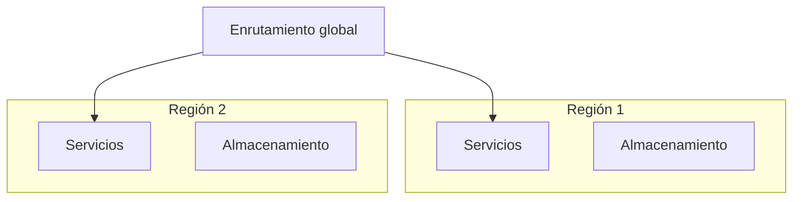

# Vista de despliegue

**Tipo:** Asignación (software a infraestructura)
**Actualizada en la iteración:** `<N>`
**Mantiene:** `<A | B | Ambos>`
**Estado:** PENDIENTE (versión inicial en la iteración 1)

## 1. Propósito

Mostrar dónde corre cada elemento. Sirve para razonar sobre escalabilidad, disponibilidad y multirregión.

## 2. Presentación primaria

<!-- Esqueleto: reemplazar en la iteración 1 y refinar en la 3. -->

## 3. Catálogo de elementos

| Nodo o recurso | Qué corre | Réplicas | Observaciones |
|---|---|---|---|
|  |  |  |  |

## 4. Rationale

| Decisión | ADR |
|---|---|
|  |  |

## 5. Drivers que sustenta

| Driver | Cómo lo sustenta |
|---|---|
| QA-4 Disponibilidad |  |
| QA-5 Escalabilidad |  |
| QA-10 Multirregión |  |

## 6. Prototipo

<!-- Qué parte de esta vista se materializa en prototype/ (por ejemplo, docker-compose). -->

## 7. Vistas relacionadas

[Componentes y conectores](cc-view.md) · [Módulos](module-view.md)
