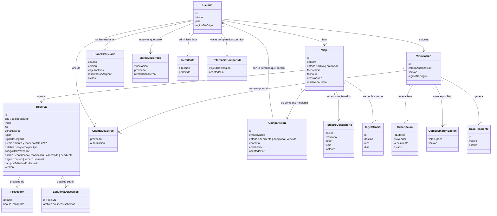

# Modelo de dominio

**Tipo:** Soporte (vocabulario)
**Actualizada en la iteración:** 4
**Mantiene:** Ambos. **Estado:** BORRADOR (propuesta inicial a discutir)

## 1. Propósito

Fijar el vocabulario del dominio antes de las iteraciones, para que las dos personas hablen de las mismas cosas.

## 2. Diagrama

## 3. Elementos

| Elemento | Descripción |
|---|---|
| Usuario | Viajero con cuenta en la plataforma. Su región de origen decide dónde se guardan sus datos (ADR-0003). El email y las credenciales viven en el proveedor de identidad de su región (ADR-0060); el idioma y el país eligen catálogo y formato (ADR-0065) |
| Viaje | Agrupación de reservas. Está completo cuando pasó la fecha de su última reserva más 2 días; una tarea diaria lo archiva y lo elimina un año después. Se reactiva si llega una novedad con fechas futuras o si el usuario lo pide; en ese caso no se archiva antes de `reactivadoHasta` (ADR-0045) |
| Reserva | Hotel, auto, vuelo, tren o autobús; puede venir de correo, de un tercero o de carga manual. Registra qué campos editó el usuario: las novedades cambian los del proveedor y conservan los del usuario (ADR-0044). Una reserva sin fechas, o con datos que no alcanzan para asociarla, queda en estado `pendiente` y aparece en "sin asignar" (ADR-0048). Tiene campos comunes que usa toda la lógica y un bloque `detalles` con esquema propio por tipo, que el núcleo valida pero no interpreta; `tipo` es un código abierto. Agregar un medio es agregar un esquema, un adaptador y su vista (ADR-0066, QA-9) |
| PanelDeUsuario | Vista precalculada del panel (`panel_por_usuario`), con la versión del último cambio. No es una entidad de negocio: es una copia para leer, reconstruible desde viajes y reservas (ADR-0040) |
| MarcaDeBorrado | Recuerda que el usuario eliminó una reserva que vino de un proveedor, para que las novedades posteriores no la recreen (ADR-0044) |
| CuentaDeCorreo | Buzón vinculado con autorización del usuario |
| Remitente | Remitente de una whitelist |
| Comparticion | Invitación del dueño a una persona por email; solo la puede aceptar una cuenta con ese email verificado (se compara `emailHmac`), y desde ahí queda atada a ese usuario como permiso de solo lectura. Se revoca en cualquier momento y se borra con el viaje (ADR-0061) |
| ReferenciaCompartida | Lo único que guarda la región de quien recibió el viaje: el identificador y la fecha de aceptación, sin datos del itinerario (ADR-0062) |
| RegistroDeAuditoria | Registro de solo agregado de cada acceso, invitación, aceptación y revocación, en la región del dueño (ADR-0061, [access-audit.md](../../specs/access-audit.md)) |
| TarjetaSocial | Resumen público de un viaje (destino, mes, días) para redes sociales; no da acceso al viaje (ADR-0063) |
| EsquemaDeDetalles | Esquema versionado de los campos propios de un tipo de reserva, en `specs/schemas/` (ADR-0066) |
| Proveedor | Aerolínea, hotel, rentadora u otro |
| Vinculacion | Relación autorizada entre usuario y cuenta o proveedor. Estado y versión autoritativos en el núcleo; ingesta conserva referencias técnicas |
| Suscripcion | Registro técnico de avisos, con identificador externo, vencimiento y estado. Ingesta administra su ciclo; entrada global tiene una proyección mínima de región |
| CursorSincronizacion | Posición opaca por flujo o carpeta, confirmada junto con resultados y outbox en ingesta; no es una versión de reserva |
| CasoPendiente | Novedad o fallo que necesita resolución; conserva motivo y evidencia mínima. Una ambigüedad de dominio pertenece al núcleo y un fallo de extracción a ingesta |

Vinculación forma parte del vocabulario funcional; suscripción, cursor y caso técnico son conceptos de soporte de
integración, no nuevos agregados obligatorios del dominio de viajes. `eventId` identifica un mensaje y no sustituye
la identidad de reserva ni del caso. Ver [contrato de ingesta](../../specs/ingestion-contract.md).

## 4. Preguntas abiertas

- ~~¿La persona con quien se comparte tiene cuenta propia?~~ Sí: resuelto en la iteración 4 (ADR-0061).
- ¿"Origen" de la reserva (correo, tercero, manual) se modela como atributo o como entidad? En la iteración 1 queda como atributo.
