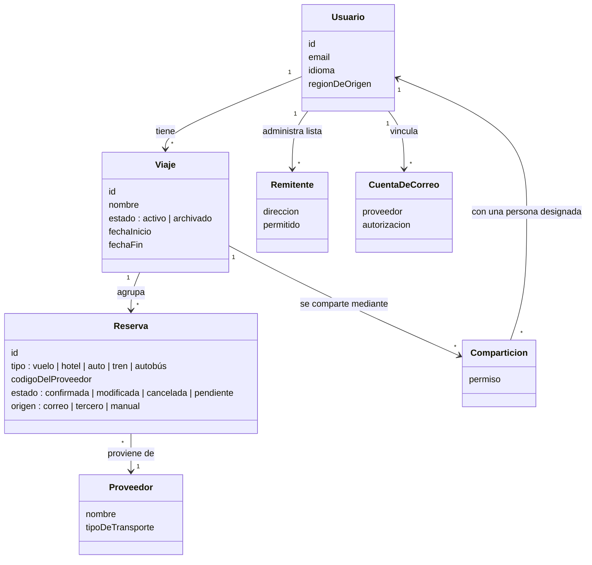

# Modelo de dominio

**Tipo:** Soporte (vocabulario)
**Actualizada en la iteración:** 1
**Mantiene:** Ambos. **Estado:** BORRADOR (propuesta inicial a discutir)

## 1. Propósito

Fijar el vocabulario del dominio antes de las iteraciones, para que las dos personas hablen de las mismas cosas.

## 2. Diagrama

## 3. Elementos

| Elemento | Descripción |
|---|---|
| Usuario | Viajero con cuenta en la plataforma. Su región de origen decide dónde se guardan sus datos (ADR-0004) |
| Viaje | Agrupación de reservas; una tarea programada del núcleo lo archiva al completarse (RF-05) |
| Reserva | Hotel, auto, vuelo, tren o autobús; puede venir de correo, de un tercero o de carga manual. Si no se puede asociar a un viaje, queda en estado `pendiente` de resolución. Agregar un medio de transporte es agregar un valor a `tipo` y un adaptador (QA-9) |
| CuentaDeCorreo | Buzón vinculado con autorización del usuario |
| Remitente | Remitente de una whitelist |
| Comparticion | Permiso de un viaje para una persona designada |
| Proveedor | Aerolínea, hotel, rentadora u otro |

## 4. Preguntas abiertas

- ¿La persona con quien se comparte tiene cuenta propia?
- ¿"Origen" de la reserva (correo, tercero, manual) se modela como atributo o como entidad? En la iteración 1 queda como atributo.
- ¿Cuándo se considera "completo" un viaje para archivarlo (fecha de fin, última reserva)?
