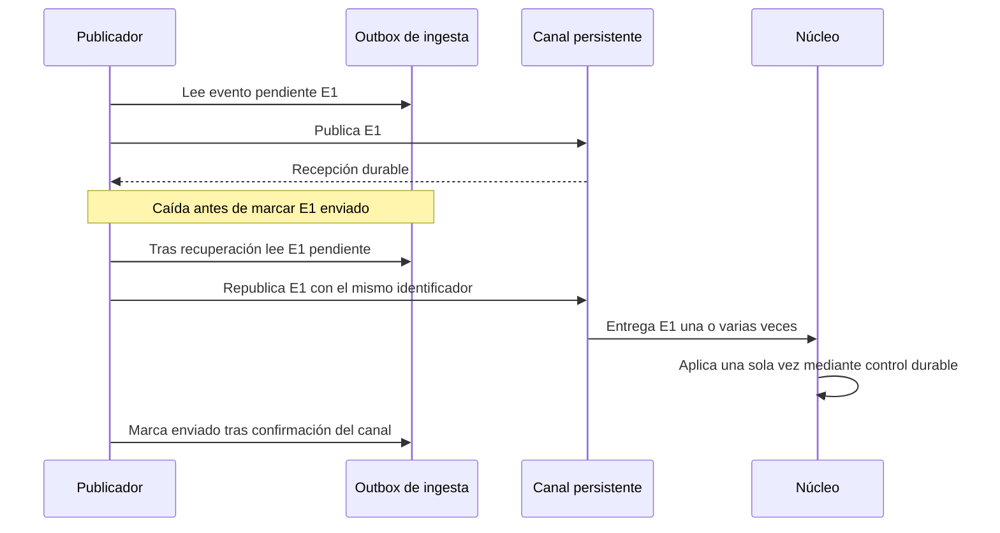
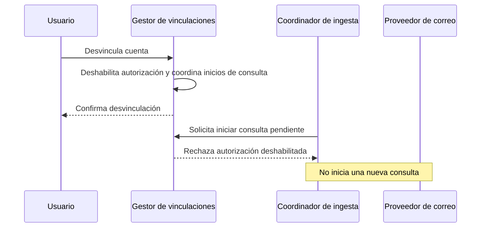

# Secuencias de ingesta

**Iteración:** 2. **Estado:** diseño propuesto; recorridos no ejecutados. **Mantiene:** responsable de ingesta.
Máximo cinco participantes por diagrama; los roles internos se agrupan para conservar legibilidad.

## SEQ-1 — Correo autorizado a publicación

```mermaid
sequenceDiagram
    participant I as Ingesta
    participant V as Vinculaciones
    participant E as Correo externo
    participant R as Registro de ingesta
    participant Q as Canal persistente
    I->>V: Solicita inicio de consulta autorizada
    alt Vinculación habilitada
        V-->>I: Acceso permitido y versión de autorización
        I->>E: Consulta incremental
        E-->>I: Página de mensajes y avance propuesto
        I->>I: Selecciona, extrae, normaliza y valida
        I->>R: Transacción: resultados, outbox y cursor con versión esperada
        R-->>I: Confirmación durable
        I->>Q: Publica pendientes con ID estable
        Q-->>I: Confirmación de recepción durable
        I->>R: Registra mensaje enviado
    else Permiso revocado o renovación inválida
        V-->>I: Rechazo; requiere revinculación
        I->>R: Registra estado sin consultar buzón
    end
```

QA-1 incluye también consumo y visualización, fuera de este recorrido. QA-8 exige acceso autorizado; los filtros
se aplican antes de conservar contenido que no sea necesario. Un resultado incompleto queda pendiente con
motivo, sin impedir guardar el avance si está representado duraderamente.

## SEQ-2 — Aviso externo por la entrada global y Gateway

```mermaid
sequenceDiagram
    participant E as Proveedor
    participant G as Entrada global y Gateway regional
    participant I as Ingesta
    participant Q as Canal regional
    participant N as Núcleo
    E->>G: Aviso con referencia de suscripción
    G->>G: Resuelve vinculación y región; comprueba contexto de origen
    G->>I: Deriva aviso al receptor interno
    I->>I: Valida proveedor/suscripción y guarda trabajo durable
    I-->>G: Confirma recepción durable
    G-->>E: Respuesta al proveedor
    I->>E: Consulta detalles si hace falta, con autorización
    E-->>I: Información externa
    I->>I: Normaliza y registra resultado/outbox
    I->>Q: booking.change.detected.v1
    Q->>N: Entrega posible más de una vez
    N->>N: Concilia y guarda resultado/control de aplicación
    N-->>Q: Confirma tras resultado durable
```

Entrada global y Gateway se agrupan en un participante para legibilidad, pero son responsabilidades distintas.
El registro mínimo de suscripciones se configura antes del aviso; si no hay una región inequívoca no se difunde
el contenido a todas las regiones. Ver [contrato regional](../../specs/notification-routing.md).
La fuente puede no ofrecer versión: se compara estado o se conserva conflicto para conciliación, no se exige
versión para toda incorporación automática. Confirmar un aviso no equivale a aplicar una reserva.

## SEQ-3 — Caída tras publicar y antes de registrar envío



El objetivo es efecto idempotente, no promesa de entrega única. Si el consumidor cae antes de confirmar, el canal
puede volver a entregar. El ID procesado y el resultado deben persistirse coordinadamente por el núcleo.

## SEQ-4 — Desvinculación y trabajos pendientes



La confirmación local debe serializarse con el inicio autorizado de llamadas; no se promete cancelar una solicitud
que ya fue enviada. Política propuesta: no iniciar nuevas consultas y no publicar nuevos datos de esa cuenta desde
trabajos aún no publicados tras comprobar su desvinculación. Coordinar ese bloqueo con el publicador. No equivale
a retirar mensajes ya entregados al canal ni borrar reservas existentes; ese alcance se define con 3/4.

[Vista](ingestion-view.md) · [Contrato](../../specs/ingestion-contract.md) · [Iteración](../01-add/iteration-2-ingestion.md).

## Configuración y revocación

El rol Vinculaciones representa la coordinación con la configuración autoritativa del núcleo. El canal exacto
se detalla antes de implementar con la iteración 3; no supone acceso de ingesta a sus tablas. El inicio de consultas
y la confirmación de revocación requieren coordinación de vigencia; una copia atrasada no demuestra QA-8.
La publicación confirmada del núcleo se describe en [core-publication.md](../../specs/core-publication.md).
La asistencia a agencias se describe en [agency-assistance.md](../../specs/agency-assistance.md).
