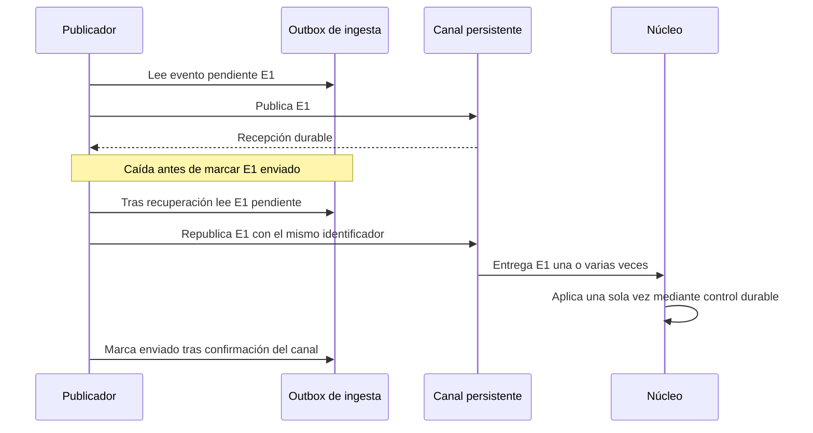
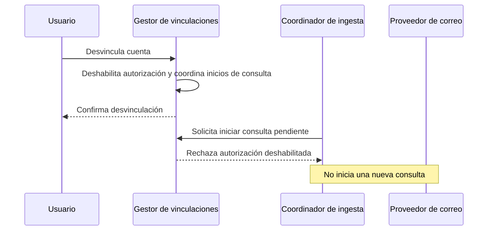

# Secuencias de ingesta

**Iteración:** 2. **Estado:** diseño propuesto; recorridos no ejecutados. **Mantiene:** responsable de ingesta.
Máximo cinco participantes por diagrama; los roles internos se agrupan para conservar legibilidad.

## SEQ-1 — Correo autorizado a publicación

```mermaid
sequenceDiagram
    participant I as Ingesta
    participant V as Vinculaciones
    participant E as Correo externo
    participant R as Registro de ingesta
    participant Q as Canal persistente
    I->>V: Solicita inicio de consulta autorizada
    alt Vinculación habilitada
        V-->>I: Acceso permitido y versión de autorización
        I->>E: Consulta incremental
        E-->>I: Página de mensajes y avance propuesto
        I->>I: Selecciona, extrae, normaliza y valida
        I->>R: Transacción: resultados, outbox y cursor con versión esperada
        R-->>I: Confirmación durable
        I->>Q: Publica pendientes con ID estable
        Q-->>I: Confirmación de recepción durable
        I->>R: Registra mensaje enviado
    else Permiso revocado o renovación inválida
        V-->>I: Rechazo; requiere revinculación
        I->>R: Registra estado sin consultar buzón
    end
```

QA-1 incluye también consumo y visualización, fuera de este recorrido. QA-8 exige acceso autorizado; los filtros
se aplican antes de conservar contenido que no sea necesario. Un resultado incompleto queda pendiente con
motivo, sin impedir guardar el avance si está representado duraderamente.

## SEQ-2 — Aviso de tercero y aplicación de novedad

```mermaid
sequenceDiagram
    participant E as Proveedor
    participant I as Ingesta
    participant R as Registro de ingesta
    participant Q as Canal persistente
    participant N as Núcleo
    E->>I: Notificación de cambio
    I->>I: Valida origen y referencia del aviso
    I->>R: Guarda trabajo pendiente e ID del aviso
    R-->>I: Confirmación durable
    I-->>E: Confirma recepción del aviso
    I->>E: Consulta estado si el aviso no trae detalle suficiente
    E-->>I: Información de reserva
    I->>I: Normaliza y valida
    I->>R: Persiste resultado y outbox
    I->>Q: booking.change.detected.v1
    Q->>N: Entrega posible más de una vez
    N->>N: Valida identidad, versión y reglas; persiste resultado atómico
    N-->>Q: Confirma tras resultado durable
```

Una API que no ofrezca avisos se sondea según ADR-0020. Confirmar un webhook no equivale a aplicar la reserva.
El consumidor registra el efecto o una resolución pendiente de modo durable antes de confirmar al canal. El evento
confirmado del núcleo para analítica es otro contrato, a refinar en 3/4.

## SEQ-3 — Caída tras publicar y antes de registrar envío



El objetivo es efecto idempotente, no promesa de entrega única. Si el consumidor cae antes de confirmar, el canal
puede volver a entregar. El ID procesado y el resultado deben persistirse coordinadamente por el núcleo.

## SEQ-4 — Desvinculación y trabajos pendientes



La confirmación local debe serializarse con el inicio autorizado de llamadas; no se promete cancelar una solicitud
que ya fue enviada. Política propuesta: no iniciar nuevas consultas y no publicar nuevos datos de esa cuenta desde
trabajos aún no publicados tras comprobar su desvinculación. Coordinar ese bloqueo con el publicador. No equivale
a retirar mensajes ya entregados al canal ni borrar reservas existentes; ese alcance se define con 3/4.

[Vista](ingestion-view.md) · [Contrato](../../specs/ingestion-contract.md) · [Iteración](../01-add/iteration-2-ingestion.md).
