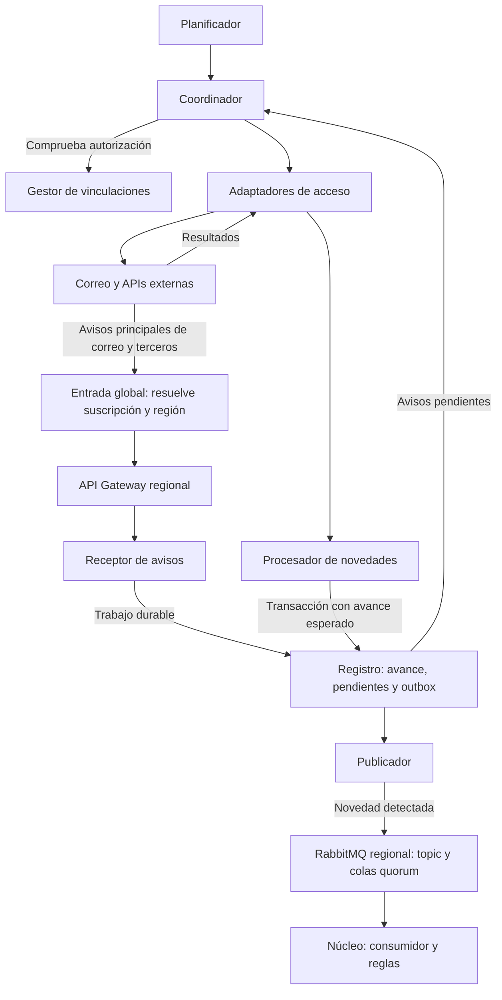

# Vista de ingesta — componentes y conectores

**Iteración:** 2. **Estado:** propuesta para revisión. **Mantiene:** responsable de ingesta.
**Propósito:** mostrar cómo las novedades externas se convierten en mensajes para el núcleo, con permisos y
publicación durable. Complementa la vista general sin reemplazar el trabajo de la iteración 1.

Las flechas representan llamadas/intercambios o lectura de pendientes, no dependencias de código. Son componentes
lógicos dentro de la unidad de ingesta, no un despliegue independiente por caja. Los avisos pueden requerir una
consulta adicional al proveedor. La fuente de datos operativos y los clientes se muestran en la vista general.

## Catálogo

| Elemento | Responsabilidad | Estado propio |
|---|---|---|
| Planificador | Reconciliación adaptable, cuotas y renovación de suscripciones | Próximos intentos y vencimientos |
| Coordinador | Comprobar vigencia y ejecutar consulta con control de concurrencia | Lease/versionado por vinculación |
| Gestor | Vigencia de configuración del núcleo por interfaz interna; renovación de tokens | Estado técnico y referencias protegidas, sin otra autoridad de permisos |
| Adaptadores | APIs, paginación y errores específicos | Ninguna escritura directa al núcleo |
| Receptor | Recibir solo por Gateway y verificar proveedor/suscripción; persistir antes de confirmar | IDs de avisos y trabajo durable |
| Asistencia del núcleo (externa a ingesta) | Módulo saliente con trabajador y adaptador de agencia | Solicitudes, seguimiento y aplicación de resultados en el núcleo |
| Procesador | Selección, extracción, normalización y validación | Resultados con motivo; no interpretar fallos como descartes |
| Registro | Guardar resultados/pendientes/outbox y avance de forma coordinada | Propiedad de ingesta |
| Publicador | Enviar, esperar confirmación y registrar envío | Intentos y fecha; ID del evento estable |
| Núcleo externo a esta unidad | Autorizar origen, conciliar, asociar a viaje y aplicar | Propiedad de iteración 3 |

## Procesamiento interno

1. Selector: filtros y whitelist para correo; validación del origen en APIs.
2. Extractor: interpretar formato de emisor/proveedor.
3. Normalizador: vocabulario y representación temporal comunes; nunca fabricar horas/IDs desconocidos.
4. Validador: producir evento publicable o resultado pendiente explícito.

El adaptador del buzón y el extractor de una confirmación de hotel son responsabilidades distintas. Un remitente
permitido no prueba por sí solo autenticidad ni convierte en seguro todo su contenido.

## Reglas de persistencia y fallos

* Cada elemento de una página obtiene un resultado durable: publicado pendiente, descarte justificado o resolución.
  Un cursor de página solo avanza después de persistir todos sus resultados; si el proveedor no pagina, se adapta
  su unidad de avance equivalente. No marcar avance global por un único elemento procesado.
* Actualización de cursor, versión de ejecución y outbox se coordinan en una transacción del registro. Una ejecución
  que perdió su lease no puede confirmar avance con una versión anterior. Tecnología concreta pendiente.
* Si la captura/transmisión falla antes de guardar, repetir la consulta. El identificador estable de origen o el
  registro de procesamiento debe reconocer elementos reobtenidos; el ID de un correo no identifica una reserva.
* Tras una publicación confirmada puede haber una caída antes de registrar envío; se reenvía el mismo evento.
* Backoff con variación para errores temporales; respetar esperas del proveedor; bloquear autorización revocada;
  errores de datos a revisión con retención/acceso definidos, no bucle infinito.
* Credenciales fuera de eventos/logs. Conservar contenido mínimo y limitar acceso a casos pendientes.
* Al desvincular, detener nuevas consultas de esa cuenta y resolver trabajos en curso según la política explícita.

## Interfaces, drivers y rationale

[Contrato](../../specs/ingestion-contract.md), [AsyncAPI](../../specs/asyncapi/booking-change-detected.v1.yaml),
[secuencias](ingestion-sequences.md). Drivers: RF-01/02/03, QA-1/6/8, CRN-3/4.
QA-5 dimensiona detección y QA-9 se evalúa agregando trenes sin modificar medios existentes.
ADRs: [0020](../03-adr/0020-obtener-novedades.md), [0021](../03-adr/0021-autorizacion-correo.md),
[0022](../03-adr/0022-tuberia-ingesta.md), [0023](../03-adr/0023-adaptadores-proveedores.md),
[0024](../03-adr/0024-avance-y-publicacion-durable.md).

## Límites

Las frecuencias de reconciliación y el coste de consultas se calculan en [políticas](../../specs/ingestion-operations.md).
El respaldo adaptable reduce solicitudes, pero no garantiza QA-1 a escala si se pierde un aviso en una cuenta de
baja frecuencia. Faltan cuotas verificadas y una recuperación acotada a escala. El gestor autoriza cada inicio de
llamada; la revocación requiere la barrera coordinada del contrato de autorización.

## Integración con la primera iteración revisada

El [contrato regional](../../specs/notification-routing.md) fija entrada global y Gateway, suscripciones y región.
La publicación ocurre en el canal de la región de origen. El consumidor verifica usuario y región.
Las versiones externas son opcionales: [contrato de novedades](../../specs/ingestion-contract.md). Se deduplican
reentregas con `eventId` y novedades de negocio con referencias de origen/huella acordadas; el estado de la reserva
se concilia en el núcleo sin asumir orden de llegada. Ingesta no se expone directamente en Internet.

El núcleo conserva la configuración autoritativa de usuarios, filtros y vinculaciones. Ingesta guarda estado
operativo de sincronización y secretos protegidos; consulta vigencia por un puerto interno, sin compartir tablas.
Ver [asistencia de agencia](../../specs/agency-assistance.md), RF-06, y [publicación del núcleo](../../specs/core-publication.md).

## Refinamiento operativo final de iteración 2

[Políticas](../../specs/ingestion-operations.md): tres miembros quorum en tres zonas por región objetivo; demo local
con un miembro sin afirmar HA. Ocho shards, consumidor activo/respaldo por shard, confirm+mandatory y ACK durable.
[Autorización](../../specs/ingestion-authorization.md): metadata autoritativa y barrera de revocación coordinada.
El paso 7 evalúa el recorrido y deja riesgos de cuotas/capacidad, no decisiones omitidas de broker.
