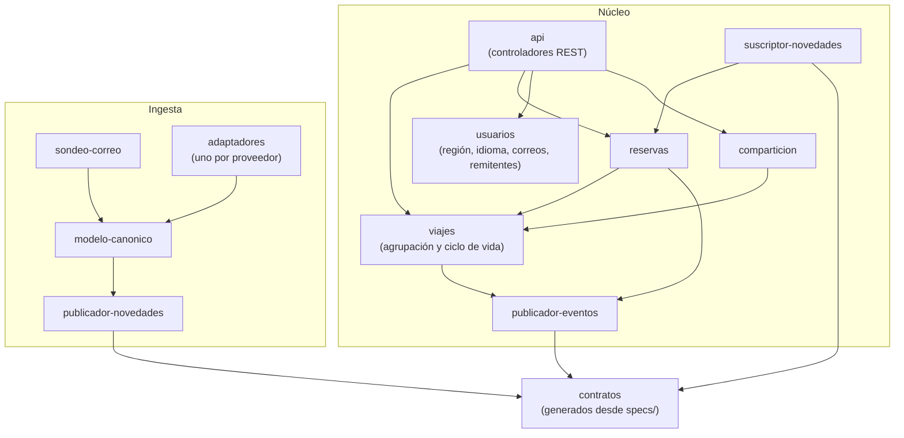

# Vista de módulos

**Tipo:** Módulos (estática)
**Actualizada en la iteración:** 1
**Mantiene:** Ambos
**Estado:** Versión inicial (iteración 1). La iteración 2 refina la ingesta y la 3 el núcleo.

## 1. Propósito

Mostrar cómo se organiza el código en módulos y qué módulo puede usar a cuál. Sirve para razonar sobre
modificabilidad y para repartir el trabajo.

## 2. Presentación primaria

Leyenda: la flecha significa "puede usar".

## 3. Catálogo de elementos

| Módulo | Responsabilidad | Directorio en `prototype/` |
|---|---|---|
| núcleo/api | Expone la API de itinerarios definida en `specs/openapi/` | `nucleo/api` |
| núcleo/viajes | Agrupa reservas por viaje; tarea programada que archiva viajes completados (RF-05) | `nucleo/viajes` |
| núcleo/reservas | Alta, cambio y baja de reservas; reservas pendientes de resolución | `nucleo/reservas` |
| núcleo/usuarios | Región de origen, idioma, cuentas de correo vinculadas y remitentes permitidos | `nucleo/usuarios` |
| núcleo/comparticion | Personas designadas por viaje (iteración 4) | `nucleo/comparticion` |
| núcleo/suscriptor-novedades | Recibe novedades del broker y las pasa a reservas | `nucleo/mensajeria` |
| núcleo/publicador-eventos | Publica los eventos de dominio de cada cambio confirmado | `nucleo/mensajeria` |
| ingesta/sondeo-correo | Lee los buzones autorizados y extrae reservas | `ingesta/correo` |
| ingesta/adaptadores | Un adaptador por proveedor (aerolínea, hotel, rentadora, …) | `ingesta/adaptadores` |
| ingesta/modelo-canonico | Representación única de una reserva, independiente del proveedor | `ingesta/canonico` |
| ingesta/publicador-novedades | Publica las reservas canónicas en el broker | `ingesta/mensajeria` |
| contratos | Tipos generados a partir de `specs/`; único código que comparten núcleo e ingesta | `contratos/` |

## 4. Reglas de dependencia

* El núcleo y la ingesta **solo comparten** el módulo `contratos`. Ninguno importa código del otro.
* Un adaptador no depende de otro adaptador: agregar trenes es agregar un adaptador y un valor al tipo de reserva.
* Los módulos de dominio del núcleo (viajes, reservas, usuarios, comparticion) no dependen de `api` ni de la
  mensajería.
* Solo `publicador-eventos` y `publicador-novedades` conocen el broker.

## 5. Rationale

| Decisión | ADR |
|---|---|
| Núcleo modular separado de la ingesta | [0001](../03-adr/0001-nucleo-modular-con-procesos-separados.md) |
| Adaptador por proveedor y modelo canónico | [0001](../03-adr/0001-nucleo-modular-con-procesos-separados.md) |
| Comunicación por mensajes con contrato | [0002](../03-adr/0002-mensajeria-persistente-con-publicacion-suscripcion.md) |

## 6. Drivers que sustenta

| Driver | Cómo lo sustenta |
|---|---|
| QA-9 Evolucionabilidad | Un medio de transporte nuevo se agrega con un adaptador nuevo, sin tocar los existentes (táctica *restringir dependencias*) |
| RF-05 | El ciclo de vida del viaje vive en un solo módulo del núcleo |

## 7. Vistas relacionadas

[Componentes y conectores](cc-view.md) · [Despliegue](deployment-view.md)
