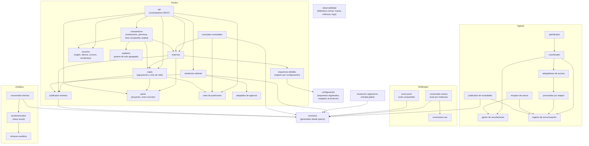

# Vista de módulos

**Tipo:** Módulos (estática)
**Actualizada en la iteración:** 4
**Mantiene:** Ambos
**Estado:** refinada en las iteraciones 2 (ingesta y asistencia), 3 (panel, ruteo de particiones y notificador) y 4
(compartición, auditoría, esquemas por tipo, analítica y observabilidad).

## 1. Propósito

Mostrar cómo se organiza el código en módulos y qué módulo puede usar a cuál. Sirve para razonar sobre
modificabilidad y para repartir el trabajo.

## 2. Presentación primaria

Leyenda: la flecha significa "puede usar".

## 3. Catálogo de elementos

| Módulo | Responsabilidad | Directorio en `prototype/` |
|---|---|---|
| núcleo/api | Expone la API de itinerarios definida en `specs/openapi/` | `nucleo/api` |
| núcleo/viajes | Agrupa reservas por viaje y asigna las que llegan sin viaje por fechas, o las deja sin asignar si no tienen fechas (ADR-0048); tarea diaria de archivado y eliminación; reactivación (ADR-0045) | `nucleo/viajes` |
| núcleo/reservas | Alta, cambio y baja de reservas con campos comunes y `details` validado (ADR-0066); aplica novedades con dueño por campo y registra campos editados por el usuario (ADR-0044); marcas de borrado; reservas pendientes de resolución | `nucleo/reservas` |
| núcleo/panel | Proyector: único escritor de `panel_por_usuario`; lo actualiza en la transacción del cambio y lo regenera desde las tablas (ADR-0040) | `nucleo/panel` |
| núcleo/ruteo-particiones | Calcula la partición de cada usuario y conoce el nodo primario; lo usan la API, el consumidor de novedades y la tarea diaria (ADR-0042) | `nucleo/datos` |
| núcleo/usuarios | Región de origen, idioma y país (ADR-0065), cuentas de correo vinculadas, remitentes permitidos y referencias a viajes compartidos conmigo (ADR-0062). Las credenciales viven en el proveedor de identidad, no acá (ADR-0060) | `nucleo/usuarios` |
| núcleo/comparticion | Invitaciones, aceptación, permisos por viaje y persona, revocación, vista compartida sin notas ni códigos, tarjeta para redes (ADR-0061, ADR-0063); acepta solo con el email invitado (`emailHmac`); intercepta todo pedido sobre un viaje ajeno | `nucleo/comparticion` |
| núcleo/auditoria | Puerto de escritura de solo agregado al registro de auditoría; si falla, la operación se rechaza (ADR-0061) | `nucleo/auditoria` |
| núcleo/esquemas-detalles | Carga al arrancar los esquemas de `details` registrados en la configuración (no se compilan) y valida cada bloque (ADR-0066) | `nucleo/esquemas` |
| analítica/consumidor-hechos | Consume con su cola, deduplica por evento y guarda recepción y hecho atómicamente antes de ACK (ADR-0064) | `analitica/consumo` |
| analítica/seudonimizador | Reemplaza identificadores según período committedAt, descarta campos fuera de la lista permitida; riesgo residual de reidentificación | `analitica/seudonimizacion` |
| analítica/almacen-analitico | Escritura y consultas pesadas del almacén analítico regional | `analitica/almacen` |
| observabilidad | Biblioteca común: propaga `correlationId` y `traceparent` (también en los mensajes), métricas por etapa y logs estructurados sin datos personales (ADR-0067) | `comun/observabilidad` |
| núcleo/suscriptor-novedades | Recibe novedades del broker y las pasa a reservas | `nucleo/mensajeria` |
| núcleo/publicador-eventos | Publica los eventos de dominio de cada cambio confirmado, incluido `booking.facts.v1` (ADR-0064) | `nucleo/mensajeria` |
| núcleo/asistencia | Autoriza asistencia, conserva seguimiento y limita trabajadores salientes | `nucleo/asistencia` |
| núcleo/adaptador-agencia | Implementa el puerto de agencia, con resultado incierto e idempotencia | `nucleo/asistencia/adaptadores` |
| ingesta/planificador | Reconciliación por prioridad y cuota; agenda renovación de suscripciones | `ingesta/planificacion` |
| ingesta/coordinador | Ejecuta trabajo con exclusión por vinculación | `ingesta/coordinacion` |
| ingesta/gestor-vinculaciones | Vigencia de autorizaciones y estado técnico de suscripciones | `ingesta/vinculaciones` |
| ingesta/adaptadores-acceso | APIs, paginación y contratos externos por proveedor | `ingesta/adaptadores` |
| ingesta/receptor-avisos | Persiste trabajo antes de confirmar recepción | `ingesta/avisos` |
| ingesta/procesador | Selección, extracción, modelo canónico y validación | `ingesta/procesamiento` |
| ingesta/registro-sincronizacion | Cursores, resultados, casos pendientes y outbox | `ingesta/persistencia` |
| ingesta/publicador-novedades | Publica novedades con identidad estable y confirma envío | `ingesta/mensajeria` |
| entrada/resolucion-regional | Directorio mínimo que resuelve suscripción y región antes del Gateway | `entrada/enrutamiento` |
| notificador/conexiones-sse | Mantiene las conexiones SSE de los usuarios conectados a la instancia (ADR-0046) | `notificador/sse` |
| notificador/consumidor-avisos | Lee `panel.changed.v1` de la cola de la instancia y avisa solo a los usuarios conectados | `notificador/avisos` |
| notificador/envio-push | Lee la cola compartida `notifier.push` y envía el push del sistema operativo | `notificador/push` |
| contratos | Tipos generados a partir de `specs/`; único código que comparten núcleo, ingesta y notificador | `contratos/` |

## 4. Reglas de dependencia

* El núcleo y la ingesta **solo comparten** el módulo `contratos`. Ninguno importa código del otro.
* Un adaptador no depende de otro adaptador: agregar un medio es agregar un adaptador, un esquema de `details` y su
  registro por configuración (ADR-0066).
* `viajes`, `panel` y la lógica de `reservas` usan solo los campos comunes; ningún módulo del núcleo interpreta los
  campos de `details` (ADR-0066).
* Todo pedido sobre un viaje ajeno, por cualquier endpoint, pasa por `comparticion`, que siempre escribe en
  `auditoria` antes de responder (ADR-0061).
* La analítica no importa código del núcleo ni accede a su base: solo `contratos` (ADR-0064).
* `observabilidad` es la única biblioteca común además de `contratos`; no contiene lógica de dominio.
* Los módulos de dominio del núcleo (viajes, reservas, usuarios, comparticion) no dependen de `api` ni de la
  mensajería.
* Los adaptadores de mensajería (publicadores y consumidores) conocen el broker; los módulos de dominio usan puertos.
* El notificador no importa código del núcleo: solo `contratos`. No accede a la base del núcleo.
* La API, el consumidor de novedades y la tarea diaria de `viajes` llegan a la base a través de `ruteo-particiones`.
* Resolución regional pertenece a entrada global, no al dominio ni al procesador de ingesta.
* Asistencia invoca su puerto saliente con recursos acotados y no importa código de ingesta.
* Solo `panel` escribe `panel_por_usuario`; `reservas` y `viajes` le piden la actualización dentro de su transacción (ADR-0040).
* Ningún módulo abre una transacción que abarque más de una partición (ADR-0042).
* Los directorios de la tabla son organización propuesta; no afirman código ya implementado.

## 5. Rationale

| Decisión | ADR |
|---|---|
| Núcleo modular separado de la ingesta | [0001](../03-adr/0001-nucleo-modular-con-procesos-separados.md) |
| Adaptador por proveedor y modelo canónico | [0001](../03-adr/0001-nucleo-modular-con-procesos-separados.md) |
| Comunicación por mensajes con contrato | [0002](../03-adr/0002-mensajeria-persistente-con-publicacion-suscripcion.md) |
| Proyector del panel como único escritor | [0040](../03-adr/0040-modelo-de-lectura-del-panel.md) |
| Reglas de novedades y cambios manuales en `reservas` | [0044](../03-adr/0044-novedades-y-cambios-manuales.md) |
| Asignación a viajes en `viajes` | [0048](../03-adr/0048-asignacion-de-reservas-a-viajes.md) |
| Notificador como proceso aparte | [0046](../03-adr/0046-notificador-de-cambios-del-panel.md) |
| Compartición y auditoría en el núcleo | [0061](../03-adr/0061-comparticion-con-cuenta-y-auditoria.md) |
| Analítica con seudonimización al entrar | [0064](../03-adr/0064-analitica-regional-anonimizada.md) |
| Idioma en el perfil, textos en los clientes | [0065](../03-adr/0065-internacionalizacion-en-el-cliente.md) |
| Esquemas de detalles por tipo | [0066](../03-adr/0066-detalles-de-reserva-extensibles-por-tipo.md) |
| Biblioteca de observabilidad | [0067](../03-adr/0067-observabilidad-con-trazas-y-metricas.md) |

## 6. Drivers que sustenta

| Driver | Cómo lo sustenta |
|---|---|
| QA-9 Evolucionabilidad | Un medio de transporte nuevo se agrega con un adaptador, un esquema y su registro, sin tocar los existentes ni la lógica del núcleo (tácticas *restringir dependencias*, *abstraer servicios comunes* y *diferir el enlace*) |
| QA-7 | Un solo módulo controla el acceso a viajes ajenos y siempre audita |
| RF-05 | El ciclo de vida del viaje vive en un solo módulo del núcleo |
| QA-2 | Un único escritor mantiene el documento del panel coherente con las tablas |

## 7. Vistas relacionadas

[Componentes y conectores](cc-view.md) · [Despliegue](deployment-view.md)
