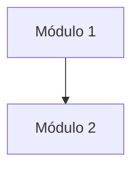

# Vista de módulos

**Tipo:** Módulos (estática)
**Actualizada en la iteración:** `<N>`
**Mantiene:** `<A | B | Ambos>`
**Estado:** PENDIENTE (se completa desde la iteración 1)

## 1. Propósito

Mostrar cómo se organiza el código en módulos y qué módulo puede usar a cuál. Sirve para razonar sobre
modificabilidad y para repartir el trabajo.

## 2. Presentación primaria

<!-- Completar en la iteración 1. Leyenda: la flecha significa "puede usar". -->

## 3. Catálogo de elementos

| Módulo | Responsabilidad | Directorio en `prototype/` |
|---|---|---|
|  |  |  |

## 4. Reglas de dependencia

<!-- Qué dependencias están prohibidas. Por ejemplo: la capa de dominio no depende de adaptadores. -->

## 5. Rationale

| Decisión | ADR |
|---|---|
|  |  |

## 6. Drivers que sustenta

| Driver | Cómo lo sustenta |
|---|---|
| QA-9 Evolucionabilidad |  |

## 7. Vistas relacionadas

[Componentes y conectores](cc-view.md) · [Despliegue](deployment-view.md)
