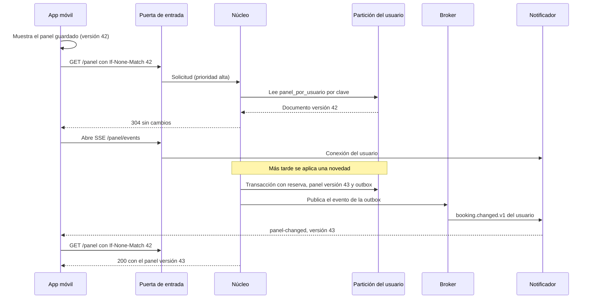
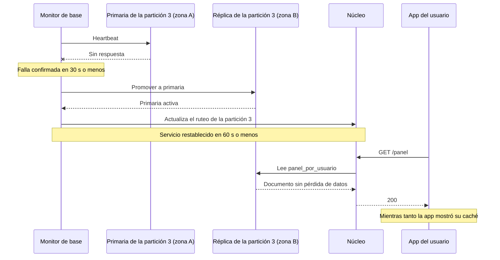
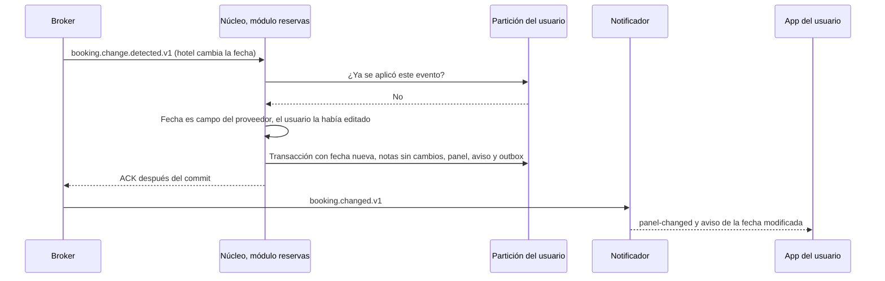

# Vistas de secuencia

**Tipo:** Comportamiento
**Mantiene:** quien documenta cada escenario
**Estado:** SEQ-1 y SEQ-2 en la iteración 2; SEQ-3, SEQ-4 y SEQ-6 en la iteración 3; SEQ-5 pendiente

Un diagrama por escenario clave. Debajo de cada uno, una descripción de qué representa y qué driver demuestra.

## Índice de secuencias

| ID | Escenario | Driver | Iteración | Estado |
|---|---|---|---|---|
| SEQ-1 | Llega un correo de reserva y se agrega al itinerario | RF-01, QA-1 | 2 | Propuesta documentada; evaluación pendiente |
| SEQ-2 | Un tercero informa una cancelación | RF-03, QA-6 | 2 | Propuesta documentada; evaluación pendiente |
| SEQ-3 | El viajero abre el panel y recibe un cambio | QA-2, QA-3, QA-1 | 3 | Propuesta |
| SEQ-4 | Falla la primaria de una partición | QA-4 | 3 | Propuesta |
| SEQ-5 | Se comparte un itinerario con otra persona | QA-7 | 4 | Pendiente |
| SEQ-6 | Una novedad pisa un campo editado por el usuario | RF-04, QA-6 | 3 | Propuesta |

## Refinamiento de SEQ-1 y SEQ-2

Los recorridos de ingesta están en [ingestion-sequences.md](ingestion-sequences.md): son diseño propuesto, no
pruebas. Incluyen sondeo autorizado del correo, avisos de terceros y consulta de detalles, recuperación de
publicación y revocación. Reemplazan el ejemplo anterior que dibujaba un correo como aviso iniciado por el proveedor
y confundía novedad detectada con cambio aplicado. SEQ-5 queda para la iteración 4.

## SEQ-3 — El viajero abre el panel y recibe un cambio

**Qué representa:** la app muestra contenido sin esperar la red (QA-3), la lectura es por clave (QA-2) y un cambio
llega a la pantalla sin consultas periódicas (etapa de cliente de QA-1). ADR-0040 y ADR-0041.

## SEQ-4 — Falla la primaria de una partición

**Qué representa:** la falla afecta solo a los usuarios de una partición y solo durante la conmutación; la réplica
sincrónica no pierde escrituras confirmadas (QA-4). Después se crea una réplica nueva. ADR-0042.

## SEQ-6 — Una novedad pisa un campo editado por el usuario

**Qué representa:** la novedad cambia los datos del proveedor y conserva los del usuario, con aviso; el control de
entrada evita aplicarla dos veces (QA-6). ADR-0044.
