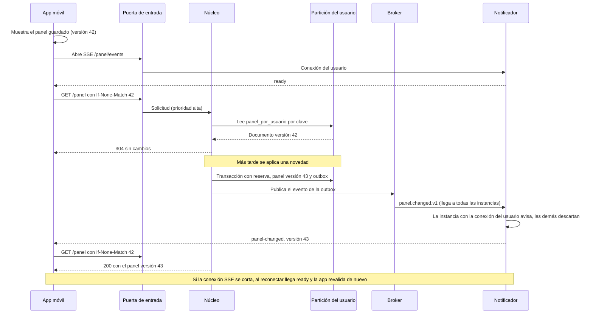
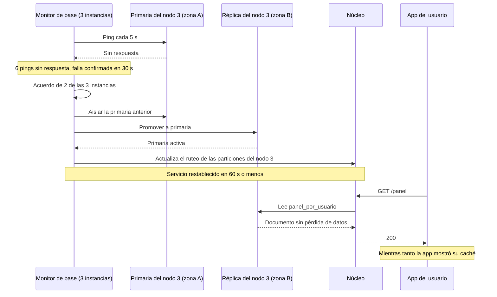
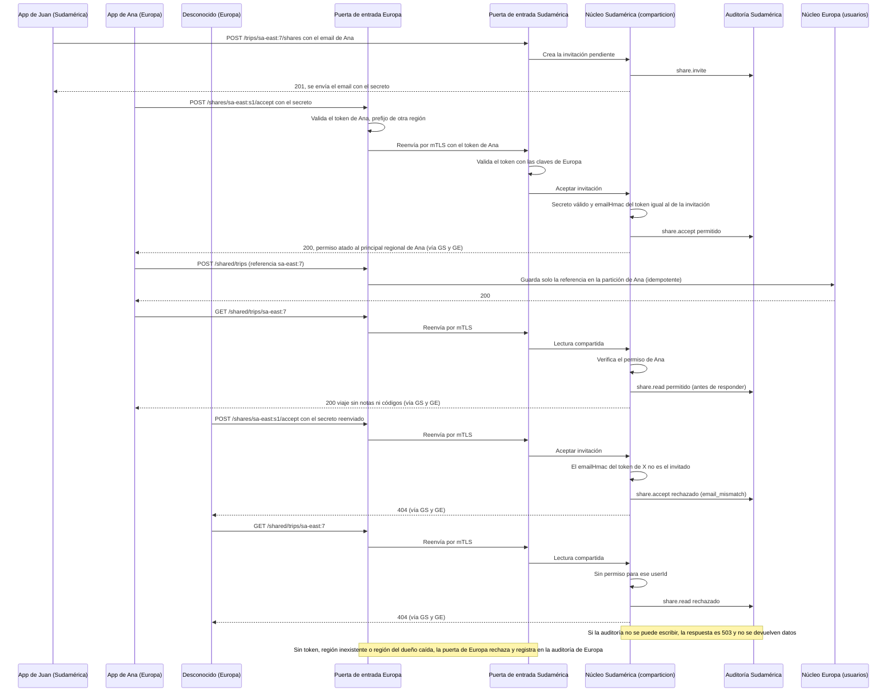
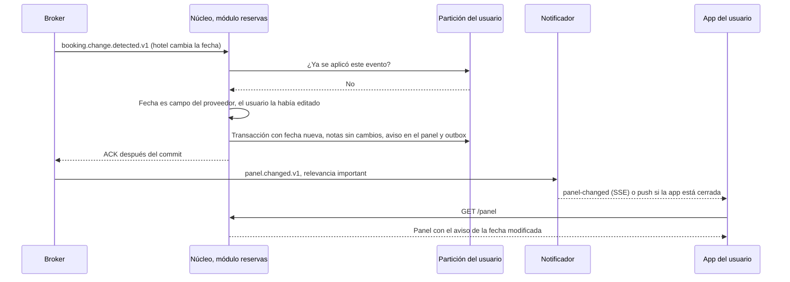
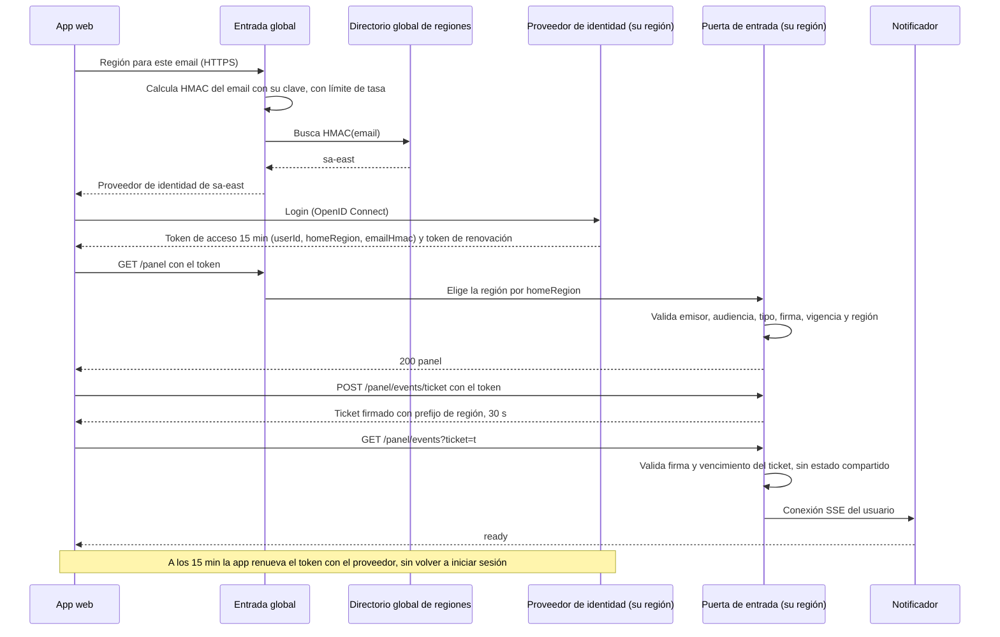

# Vistas de secuencia

**Tipo:** Comportamiento
**Mantiene:** quien documenta cada escenario
**Estado:** SEQ-1 y SEQ-2 en la iteración 2; SEQ-3, SEQ-4 y SEQ-6 en la iteración 3; SEQ-5 y SEQ-7 en la iteración 4

Un diagrama por escenario clave. Debajo de cada uno, una descripción de qué representa y qué driver demuestra.

## Índice de secuencias

| ID | Escenario | Driver | Iteración | Estado |
|---|---|---|---|---|
| SEQ-1 | Llega un correo de reserva y se agrega al itinerario | RF-01, QA-1 | 2 | Propuesta documentada; evaluación pendiente |
| SEQ-2 | Un tercero informa una cancelación | RF-03, QA-6 | 2 | Propuesta documentada; evaluación pendiente |
| SEQ-3 | El viajero abre el panel y recibe un cambio | QA-2, QA-3, QA-1 | 3 | Propuesta |
| SEQ-4 | Falla la primaria de un nodo de la base | QA-4 | 3 | Propuesta |
| SEQ-5 | Se comparte un itinerario con una persona de otra región | QA-7, RF-08 | 4 | Propuesta |
| SEQ-6 | Una novedad pisa un campo editado por el usuario | RF-04, QA-6 | 3 | Propuesta |
| SEQ-7 | El viajero inicia sesión y abre la conexión de avisos | QA-7 | 4 | Propuesta |

## Refinamiento de SEQ-1 y SEQ-2

Los recorridos de ingesta están en [ingestion-sequences.md](ingestion-sequences.md): son diseño propuesto, no
pruebas. Incluyen sondeo autorizado del correo, avisos de terceros y consulta de detalles, recuperación de
publicación y revocación. Reemplazan el ejemplo anterior que dibujaba un correo como aviso iniciado por el proveedor
y confundía novedad detectada con cambio aplicado.

## SEQ-3 — El viajero abre el panel y recibe un cambio

**Qué representa:** la app muestra contenido sin esperar la red (QA-3), la lectura es por clave (QA-2) y un cambio
llega a la pantalla sin consultas periódicas (etapa de cliente de QA-1). La app abre SSE **antes** de revalidar, para
que un cambio entre ambos pasos no se pierda, y revalida de nuevo cada vez que SSE reconecta. ADR-0040, ADR-0041 y
ADR-0046.

## SEQ-4 — Falla la primaria de un nodo de la base

**Qué representa:** la falla afecta solo a los usuarios de una partición y solo durante la conmutación; la réplica
sincrónica no pierde escrituras confirmadas (QA-4). La falla afecta a los usuarios de todas las particiones de ese
nodo. Después se crea una réplica nueva (en la zona C si cayó una zona entera). ADR-0042.

## SEQ-5 — Se comparte un itinerario con una persona de otra región

**Qué representa:** solo una cuenta con el email invitado puede aceptar, y desde ahí el permiso queda atado a esa
cuenta, así que reenviar el enlace no da acceso ni antes ni después de aceptar; cada intento, permitido o rechazado,
queda registrado antes de responder (QA-7). El estado de Juan se lee en su región; la respuesta autorizada transita por Europa sin persistirse allí. La app de
Ana registra en Europa solo la referencia al viaje (CON-3, RF-08). ADR-0060, ADR-0061 y ADR-0062.

## SEQ-6 — Una novedad pisa un campo editado por el usuario

**Qué representa:** la novedad cambia los datos del proveedor y conserva los del usuario, con aviso; el control de
entrada evita aplicarla dos veces (QA-6). ADR-0044 y ADR-0046.

## SEQ-7 — El viajero inicia sesión y abre la conexión de avisos

**Qué representa:** la puerta de entrada valida cada token sin consultar al proveedor de identidad ni guardar
sesiones (QA-5), y el navegador abre la conexión SSE con un ticket firmado porque no puede enviar el encabezado
`Authorization` (QA-7). El directorio global solo guarda el HMAC del email, calculado por la entrada global con una
clave propia, y la región (CON-3). ADR-0060.
