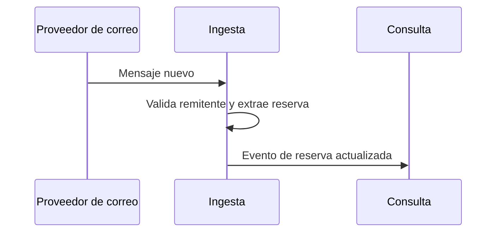

# Vistas de secuencia

**Tipo:** Comportamiento
**Mantiene:** quien documenta cada escenario
**Estado:** PENDIENTE

Un diagrama por escenario clave. Debajo de cada uno, una descripción de qué representa y qué driver demuestra.

## Índice de secuencias

| ID | Escenario | Driver | Iteración | Estado |
|---|---|---|---|---|
| SEQ-1 | Llega un correo de reserva y se agrega al itinerario | RF-01, QA-1 | 2 | Pendiente |
| SEQ-2 | Un tercero informa una cancelación | RF-03, QA-6 | 2 | Pendiente |
| SEQ-3 | El viajero consulta su panel de viajes | QA-2, QA-3 | 3 | Pendiente |
| SEQ-4 | Falla una instancia y el tráfico se redirige | QA-4 | 3 | Pendiente |
| SEQ-5 | Se comparte un itinerario con otra persona | QA-7 | 4 | Pendiente |

## SEQ-1 — Correo de reserva

<!-- Esqueleto con tres participantes para que renderice. Completar en la iteración 2. -->

**Qué representa:** `<descripción>`
**Medida a verificar:** QA-1, 5 minutos.

<!-- Copiar el bloque de SEQ-1 para cada una de las demás. -->
