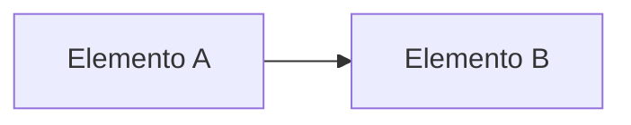

# <Nombre de la vista>

**Tipo:** Módulos | C&C | Asignación | Comportamiento
**Actualizada en la iteración:** `<N>`
**Mantiene:** `<A | B | Ambos>`

## 1. Propósito

<!-- Para quién es y qué preguntas permite responder. -->

## 2. Presentación primaria

<!-- Leyenda: qué significan las formas y flechas. -->

## 3. Catálogo de elementos

| Elemento | Responsabilidad | Tecnología (si aplica) |
|---|---|---|
|  |  |  |

## 4. Relaciones e interfaces

| De | A | Tipo de relación | Contrato (`specs/`) |
|---|---|---|---|
|  |  |  |  |

## 5. Comportamiento (si aplica)

<!-- Enlazar a sequence-views.md. -->

## 6. Rationale

<!-- Por qué se ve así. Enlazar las ADRs. -->

| Decisión | ADR |
|---|---|
|  |  |

## 7. Drivers que sustenta

| Driver | Cómo lo sustenta esta vista |
|---|---|
|  |  |

## 8. Vistas relacionadas

<!-- Links. -->
