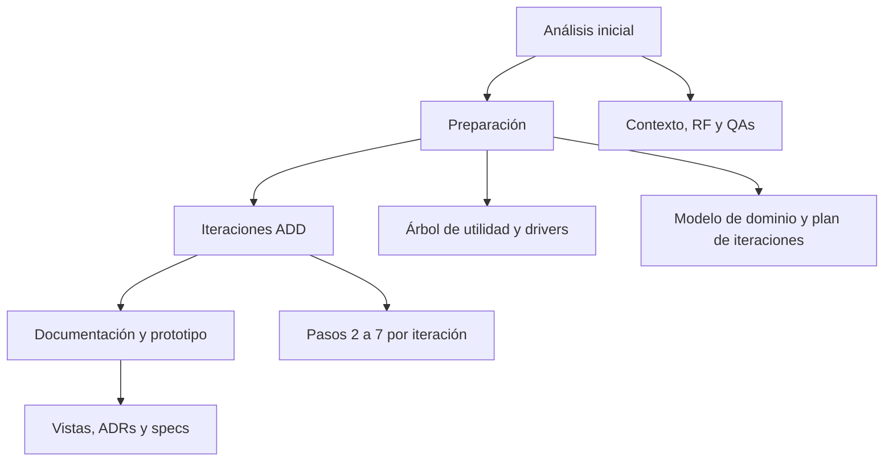

# Mapa del proceso y herramientas

Esta guía dice qué artefacto produce cada etapa y qué skill o técnica conviene usar. Los nombres de las skills son
los comandos disponibles en el proyecto de Claude.

## Flujo general

## Qué usar en cada etapa

| Etapa | Artefacto | Herramienta |
|---|---|---|
| Alcance | [Diagrama de contexto](00-requirements/context-diagram.md) | Keeling, actividad 22 (Context Diagram) |
| Requerimientos funcionales | [functional-rqmts.md](00-requirements/functional-rqmts.md) | `/generador-casos-de-uso` |
| Atributos de calidad | [quality-attribute-scenarios.md](00-requirements/quality-attribute-scenarios.md) | `/generador-qas` para generar y `/test-qas` para auditar |
| Descubrir QAs en equipo | Taller corto | Keeling: Quality Attribute Web (6), Mini-QAW (7), Response Measure Straw Man (9) |
| Priorización | [utility-tree.md](00-requirements/utility-tree.md) | `/arbol-utilidad` |
| Drivers | [architectural-drivers.md](00-requirements/architectural-drivers.md) | Bass cap. 19 (ASRs) |
| Iteraciones | [01-add/](01-add/) | Bass cap. 20 (ADD 3.0); Keeling: diseño guiado por riesgos |
| Elegir entre alternativas | Tabla en la iteración y en la ADR | Keeling: Decision Matrix (32) y Paths Not Taken (26) |
| Elegir tácticas y patrones | Paso 4 de cada iteración | Bass, catálogo de tácticas por QA (caps. 4 a 13) |
| Vistas | [02-views/](02-views/) | Bass cap. 22 (Views and Beyond); Keeling caps. 10 y 11 |
| Decisiones | [03-adr/](03-adr/) | Plantilla MADR; Keeling actividad 20 |
| Cierre de cada iteración (paso 7) | Sección "Análisis" de la iteración | Keeling: Scenario Walkthrough (37) y Risk Storming (35) |

## Orden recomendado de los primeros días

1. Contexto y requerimientos funcionales (juntos).
2. QAs con `/generador-qas`, auditados con `/test-qas`. Los números que no vienen del enunciado quedan marcados como
   suposición para validar con los docentes.
3. Árbol de utilidad con `/arbol-utilidad`. Los (H, H) son los drivers de las iteraciones.
4. Modelo de dominio y plan de iteraciones.
5. Iteración 1 (juntos). Desde la 2 se reparten.

## Convenciones de documentación

- Todo en Markdown; los diagramas en Mermaid (se ven directo en GitHub).
- Cada archivo empieza con un encabezado que dice **qué es** y **quién lo mantiene**.
- Los links son relativos para que sirvan tanto en el repo como en la Wiki.
- Lo que no viene del enunciado y se asumió se marca como **Suposición** con su criterio.
